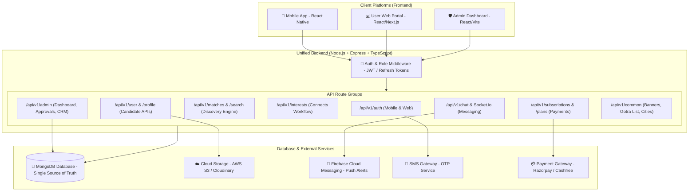
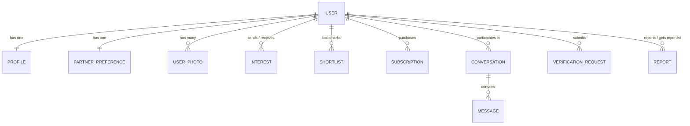
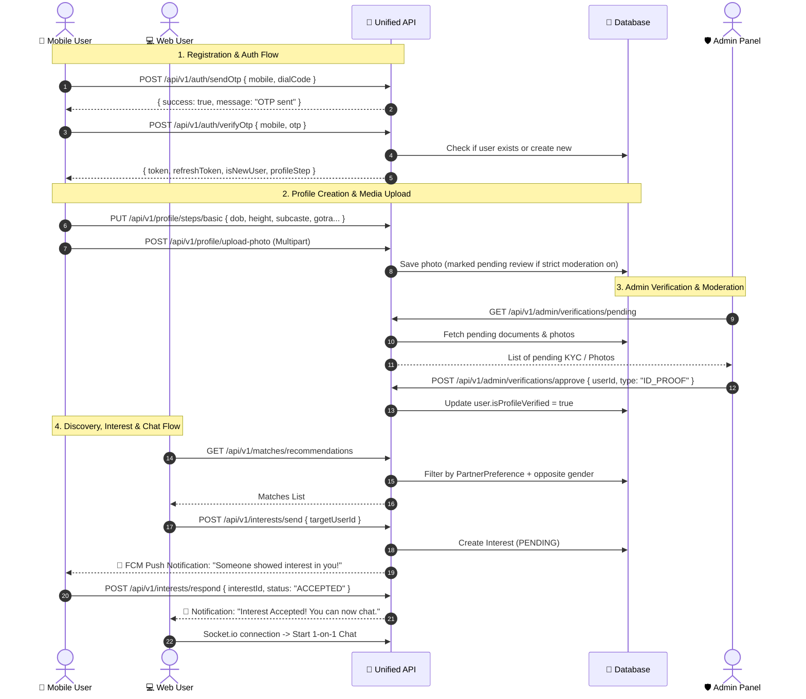

# 💍 Sindhi Matrimony – Unified Backend Architecture & Flow Specification
**Single Backend for: Mobile App (React Native) + User Web App + Admin Panel**

---

## 1. Executive Overview & System Architecture

This architecture defines a **single, unified backend** (`sindhiMatrimonyBackhend`) designed to serve three distinct client platforms without code duplication or fragmented databases:
1. **Mobile App** (`sindhiMatrimony`): React Native (iOS & Android)
2. **User Web Portal** (`sindhiMatrimonyUser`): Responsive Web Portal for candidates & parents
3. **Admin Dashboard** (`sindiMatrimonyAdmin`): Web panel for CRM, profile verification, membership billing, and moderation



---

## 2. Role-Based Access Control (RBAC) & Security

All clients interact through standard JWT Bearer authentication:
* **Headers:** `Authorization: Bearer <accessToken>`

| Role | Allowed Platforms | Access Scope |
| :--- | :--- | :--- |
| `USER` | Mobile App, User Web | View matches, edit own profile, send/accept interests, chat, buy plans |
| `ADMIN` | Admin Panel | Full system access: manage users, verify KYC/IDs, manage plans, view revenue |
| `MODERATOR` | Admin Panel | Review photos, approve/reject verification requests, handle user reports |

---

## 3. Core Database Schema & Entity Relationships



### 3.1. `User` Schema
* `_id`: ObjectId
* `mobile`: String (Indexed, unique)
* `dialCode`: String (e.g. `+91`)
* `email`: String (Optional / Unique)
* `password`: String (Hashed bcrypt - for password login)
* `role`: Enum [`USER`, `ADMIN`, `MODERATOR`]
* `status`: Enum [`ACTIVE`, `PENDING_VERIFICATION`, `SUSPENDED`, `DELETED`]
* `accountType`: Enum [`SELF`, `PARENT`, `SIBLING`, `RELATIVE`]
* `fcmTokens`: Array of Strings (For multi-device push notifications)
* `isMobileVerified`: Boolean
* `isEmailVerified`: Boolean
* `isProfileVerified`: Boolean (Blue Tick Badge)
* `membershipTier`: Enum [`FREE`, `SILVER`, `GOLD`, `PLATINUM`]
* `membershipExpiresAt`: Date
* `lastActiveAt`: Date
* `createdAt`, `updatedAt`: Timestamps

### 3.2. `Profile` Schema (Detailed Matrimony Information)
* `userId`: Ref -> User (Unique)
* **Basic Details:**
  * `fullName`: String
  * `gender`: Enum [`MALE`, `FEMALE`]
  * `dob`: Date
  * `age`: Number (Computed or stored)
  * `heightCm`: Number (e.g. 175 cm / 5ft 9in)
  * `maritalStatus`: Enum [`NEVER_MARRIED`, `DIVORCED`, `WIDOWED`, `AWAITING_DIVORCE`]
  * `motherTongue`: String (Default: "Sindhi")
  * `physicalStatus`: Enum [`NORMAL`, `PHYSICALLY_CHALLENGED`]
* **Location:**
  * `country`: String
  * `state`: String
  * `city`: String
  * `citizenship`: String
* **Religious & Astrological (Sindhi Community Specific):**
  * `religion`: String (Default: "Hindu")
  * `caste`: String (e.g. "Sindhi")
  * `subcaste`: String (e.g. "Baibhand", "Amil", "Sahiti", "Larkana", "Shikarpuri", "Dadu", etc.)
  * `gotra`: String
  * `rashi`: String (e.g. "Simha / Leo")
  * `nakshatra`: String
  * `manglik`: Enum [`YES`, `NO`, `DON'T_KNOW`, `ANSCHIK`]
  * `horoscopeUrl`: String (Uploaded Kundli PDF / Image)
* **Education & Career:**
  * `highestEducation`: String (e.g. "B.Tech", "MBA", "CA", "MBBS")
  * `educationDetail`: String
  * `employedIn`: Enum [`PRIVATE`, `GOVERNMENT`, `BUSINESS`, `DEFENCE`, `NOT_WORKING`]
  * `occupation`: String (e.g. "Software Engineer", "Business Owner")
  * `companyName`: String
  * `annualIncome`: String (e.g. "10 - 15 Lakhs")
* **Family Details:**
  * `familyType`: Enum [`NUCLEAR`, `JOINT`]
  * `familyStatus`: Enum [`MIDDLE_CLASS`, `UPPER_MIDDLE_CLASS`, `RICH_AFFLUENT`]
  * `fatherOccupation`: String
  * `motherOccupation`: String
  * `brothersCount`: Number
  * `brothersMarried`: Number
  * `sistersCount`: Number
  * `sistersMarried`: Number
  * `familyNativeCity`: String
  * `aboutFamily`: String
* **Lifestyle & Habits:**
  * `diet`: Enum [`VEGETARIAN`, `NON_VEGETARIAN`, `EGGETARIAN`, `JAIN`]
  * `smoking`: Enum [`NO`, `OCCASIONALLY`, `YES`]
  * `drinking`: Enum [`NO`, `OCCASIONALLY`, `YES`]
  * `hobbies`: Array of Strings
  * `aboutMe`: String (Bio)
* **Profile Media:**
  * `avatar`: String (Primary profile photo URL)
  * `photos`: Array of `{ url: String, isApproved: Boolean, isPrivate: Boolean, createdAt: Date }`
  * `profileCompletionPercentage`: Number (0 - 100%)

### 3.3. `PartnerPreference` Schema
* `userId`: Ref -> User
* `ageMin`: Number, `ageMax`: Number
* `heightMinCm`: Number, `heightMaxCm`: Number
* `maritalStatus`: Array of Strings
* `subcastes`: Array of Strings (or `['ANY']`)
* `manglik`: Enum [`YES`, `NO`, `DOES_NOT_MATTER`]
* `education`: Array of Strings
* `employedIn`: Array of Strings
* `annualIncomeMin`: Number
* `countries`: Array of Strings
* `states`: Array of Strings
* `cities`: Array of Strings
* `diet`: Array of Strings

### 3.4. `Interest` (Connection Request) Schema
* `senderId`: Ref -> User
* `receiverId`: Ref -> User
* `status`: Enum [`PENDING`, `ACCEPTED`, `DECLINED`, `CANCELLED`]
* `respondedAt`: Date
* `createdAt`: Date

### 3.5. `Chat` & `Message` Schema
* **Conversation:** `participants: [User1, User2]`, `lastMessage: Ref`, `unreadCounts: { user1: 0, user2: 0 }`
* **Message:** `conversationId`, `senderId`, `receiverId`, `messageText`, `messageType: ['TEXT', 'IMAGE']`, `isRead: Boolean`

### 3.6. `Subscription` & `MembershipPlan` Schema
* **Plan:** `name`, `tier`, `priceINR`, `validityDays`, `contactsViewLimit`, `chatEnabled`, `profileBoost`, `features: []`
* **UserSubscription:** `userId`, `planId`, `paymentGatewayOrderId`, `paymentId`, `status: ['ACTIVE', 'EXPIRED']`, `contactsViewedRemaining: Number`, `expiresAt: Date`

---

## 4. End-to-End User & Admin Flows



---

## 5. Complete API Endpoints Specification

### 🔑 Authentication Module (`/api/v1/auth`)
* `POST /send-otp` – Sends OTP for login/register
* `POST /verify-otp` – Verifies OTP, creates/logs in user, returns JWT tokens
* `POST /login-password` – Login via Mobile/Email + Password
* `POST /register` – Full registration flow
* `POST /forgot-password/send-otp` – OTP for password recovery
* `POST /forgot-password/verify-otp` – Verify recovery OTP
* `POST /forgot-password/reset` – Set new password
* `POST /refresh-token` – Issues new access token using refresh token
* `POST /logout` – Clears active session and FCM token

### 👤 Profile & Preferences Module (`/api/v1/profile`)
* `GET /me` – Fetch logged-in user's profile and completion percentage
* `PUT /basic-details` – Update personal, gotra, rashi, height, location
* `PUT /family-details` – Update family background, father/mother details
* `PUT /career-details` – Update education, profession, income
* `PUT /lifestyle-details` – Update diet, habits, bio
* `POST /upload-photo` – Upload profile photo / album pictures
* `DELETE /photo/:photoId` – Remove a photo
* `PUT /set-avatar/:photoId` – Set a photo as primary display picture
* `GET /partner-preference` – Get partner preferences
* `PUT /partner-preference` – Update partner preferences
* `POST /verify-id-proof` – Submit Aadhaar/Govt ID proof for verification badge

### 🔍 Discovery & Matches Module (`/api/v1/matches`)
* `GET /daily-recommendations` – Smart matches matching user's partner preferences
* `GET /just-joined` – New registered profiles (last 7/14 days)
* `GET /near-me` – Matches within same city/state
* `GET /verified-profiles` – Only ID-verified profiles
* `POST /search` – Advanced filter search (Age range, Height, Subcaste/Gotra, City, Education, Diet)
* `GET /view/:userId` – View public profile of a candidate (respecting privacy rules)

### ❤️ Interests & Shortlists Module (`/api/v1/interests`)
* `POST /send` – Send interest to a user
* `POST /respond` – Accept or decline received interest (`ACCEPTED` / `DECLINED`)
* `POST /cancel` – Cancel sent interest
* `GET /received` – List received interests (with status filter)
* `GET /sent` – List sent interests
* `POST /shortlist/:userId` – Bookmark/save a profile
* `DELETE /shortlist/:userId` – Remove profile from bookmarks
* `GET /shortlist` – List bookmarked profiles

### 💬 Real-Time Chat Module (`/api/v1/chat` + Socket.io)
* `GET /conversations` – List active conversations with last message and unread count
* `GET /messages/:conversationId` – Fetch chat history with pagination
* `POST /send-message` – REST fallback for sending message
* `Socket Events:`
  * `join_chat`: Join private room
  * `send_message`: Real-time message delivery
  * `message_read`: Read receipt update
  * `typing`: Typing indicator

### 💳 Plans & Monetization Module (`/api/v1/subscriptions`)
* `GET /plans` – List active membership tiers and benefits
* `POST /create-order` – Create Razorpay/Payment Gateway order
* `POST /verify-payment` – Verify payment signature & activate plan
* `GET /my-subscription` – Active plan details, expiry date, remaining contact views
* `POST /unlock-contact/:userId` – Deduct 1 credit & unlock candidate phone/email

### 🛡️ Admin Dashboard Module (`/api/v1/admin`)
* `GET /dashboard-stats` – Total users, male/female count, daily registrations, active subscriptions, revenue
* `GET /users` – Paginated user list with filters (Status, Verification, Subcaste, Created date)
* `GET /users/:userId` – Full 360-degree user inspection
* `PUT /users/:userId/status` – Block, suspend, or activate user account
* `GET /verifications/pending` – Queue of submitted ID proofs & documents
* `POST /verifications/:id/action` – Approve or reject with reason
* `GET /reported-users` – User complaints and harassment reports
* `POST /reported-users/:id/resolve` – Dismiss or ban reported user
* `CRUD /plans` – Manage membership packages and pricing
* `POST /broadcast-notification` – Send targeted push notifications to all or specific users

### 🌐 Common & Master Data Module (`/api/v1/common`)
* `GET /banners` – Home screen banners and announcements
* `GET /subcastes` – Predefined list of Sindhi subcastes (Amil, Bhaiband, Sindhi Sikh, etc.)
* `GET /gotras` – Sindhi gotra list for dropdown selection
* `GET /locations` – List of countries, states, and cities

---

## 6. Target Project Folder Structure (`sindhiMatrimonyBackhend`)

```
sindhiMatrimonyBackhend/
├── package.json
├── tsconfig.json
├── .env.example
├── src/
│   ├── app.ts                 # Express application configuration
│   ├── server.ts              # Server startup & Socket.io initialization
│   ├── config/
│   │   ├── db.ts              # MongoDB Mongoose connection
│   │   ├── env.ts             # Environment variables validation
│   │   └── firebase.ts        # Firebase Admin SDK for FCM
│   ├── models/                # Mongoose Models
│   │   ├── User.ts
│   │   ├── Profile.ts
│   │   ├── PartnerPreference.ts
│   │   ├── Interest.ts
│   │   ├── Shortlist.ts
│   │   ├── Conversation.ts
│   │   ├── Message.ts
│   │   ├── Plan.ts
│   │   ├── Subscription.ts
│   │   ├── Verification.ts
│   │   └── Report.ts
│   ├── controllers/           # Business Logic
│   │   ├── auth.controller.ts
│   │   ├── profile.controller.ts
│   │   ├── matches.controller.ts
│   │   ├── interest.controller.ts
│   │   ├── chat.controller.ts
│   │   ├── subscription.controller.ts
│   │   ├── admin.controller.ts
│   │   └── common.controller.ts
│   ├── routes/                # Express Route Handlers
│   │   ├── index.ts           # Central router (/api/v1)
│   │   ├── auth.routes.ts
│   │   ├── profile.routes.ts
│   │   ├── matches.routes.ts
│   │   ├── interest.routes.ts
│   │   ├── chat.routes.ts
│   │   ├── subscription.routes.ts
│   │   ├── admin.routes.ts
│   │   └── common.routes.ts
│   ├── middlewares/           # Interceptors
│   │   ├── auth.middleware.ts # JWT verification
│   │   ├── role.middleware.ts # Admin/User role checks
│   │   ├── upload.middleware.ts # Multer for photos/docs
│   │   ├── error.middleware.ts
│   │   └── validator.middleware.ts
│   ├── services/              # External Integrations
│   │   ├── otp.service.ts
│   │   ├── fcm.service.ts
│   │   ├── s3.service.ts
│   │   └── payment.service.ts
│   ├── sockets/               # Real-time WebSockets
│   │   └── chat.socket.ts
│   └── utils/
│       ├── apiResponse.ts     # Standardized JSON response wrapper
│       └── logger.ts
```

---

## 7. Implementation Roadmap

1. **Step 1:** Initialize Node.js + Express + TypeScript in `sindhiMatrimonyBackhend` with MongoDB connection.
2. **Step 2:** Implement Core Models (`User`, `Profile`, `PartnerPreference`) & Authentication (`/api/v1/auth`) with JWT and OTP.
3. **Step 3:** Implement Profile Onboarding & Edit Profile APIs matching the React Native screens (`editProfile`, `managePhotos`, `verifyYourProfile`).
4. **Step 4:** Implement Discovery, Search & Interest workflows (`matchesScreen`, `searchScreen`, `interestsScreen`).
5. **Step 5:** Implement Real-time Chat (Socket.io) and Push Notifications (Firebase FCM).
6. **Step 6:** Implement Membership & Subscriptions (`upgradeScreen` + Payment Gateway).
7. **Step 7:** Build Admin Dashboard APIs for CRM, KYC approvals, and statistics.
