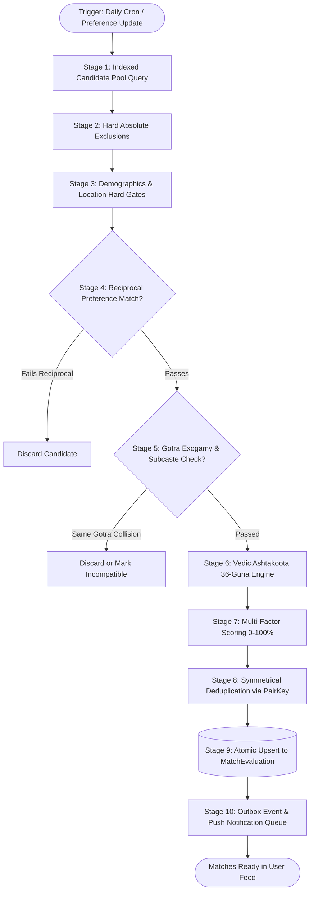

# 💍 Sindhi Matrimony – Backend Automated Matchmaking System
## Complete Production-Grade Architecture, Algorithms, Schemas, APIs, and Operational Workflows
**Target Service:** `sindhiMatrimonyBackhend` (Node.js + Express + TypeScript + MongoDB + Redis)  
**Client Consumers:** React Native App (`sindhiMatrimony`), User Web (`sindhiMatrimonyUser`), Admin/CRM (`sindiMatrimonyAdmin`)

---

## 1. Executive Summary & Architectural Scope

The **Automated Matchmaking Engine (AME)** is the core intelligence layer of the Sindhi Matrimony backend platform. It evaluates, filters, scores, ranks, and delivers hyper-relevant matrimonial candidates while respecting cultural traditions (such as Sindhi subcaste and Gotra exogamy), strict privacy settings, reciprocal preferences, and optional Vedic astrological compatibility (Ashtakoota 36-Guna Milan & Manglik Kuja Dosha).

```
┌────────────────────────────────────────────────────────────────────────────────────────┐
│                          AUTOMATED MATCHMAKING SYSTEM TOPOLOGY                         │
├────────────────────────────────────────────────────────────────────────────────────────┤
│                                                                                        │
│  [ EVENT TRIGGERS ]                                                                    │
│  • Profile Activation / Verification       • Daily Scheduled Cron (08:00 AM IST)       │
│  • Partner Preference Update               • Manual Admin / RM Re-evaluation           │
│  • Location / Education / Career Update    • Reciprocal Eligibility Change             │
│                                    │                                                   │
│                                    ▼                                                   │
│  ┌──────────────────────────────────────────────────────────────────────────────────┐  │
│  │                     THE 10-STAGE CANDIDATE FILTER & SCORING PIPELINE             │  │
│  │                                                                                  │  │
│  │  1. Fast Indexed Base Query    ──► Opposite Gender, Active, Verified             │  │
│  │  2. Absolute Hard Exclusions   ──► Self, Blocked, Reported, Hidden, Deleted      │  │
│  │  3. Hard Preference Gates      ──► Age Bounds, Marital Status, City/Region       │  │
│  │  4. Reciprocal Preference Gate ──► Candidate accepts Member (Unilateral/Bilateral│  │
│  │  5. Cultural & Gotra Exogamy   ──► Same-Gotra Rules & Subcaste Policy            │  │
│  │  6. Optional Horoscope Engine  ──► 36-Guna Ashtakoota & Manglik Dosha            │  │
│  │  7. Multi-Factor Scoring       ──► Preference (35), Age (20), Loc (15), etc.     │  │
│  │  8. Deduplication & History    ──► Lexicographical PairKey & Dismissed Filtering │  │
│  │  9. Atomic Persistence         ──► MongoDB MatchEvaluation & Redis MatchCache    │  │
│  │  10. Outbox Event Publication  ──► Push Alerts, Daily Digest Queue, RM CRM Desk  │  │
│  └──────────────────────────────────────────────────────────────────────────────────┘  │
│                                    │                                                   │
│                                    ▼                                                   │
│  [ DISPATCH CHANNELS & CONSUMERS ]                                                     │
│  • Mobile App Discovery API (`GET /api/v1/matches/daily`)                              │
│  • Notification Outbox Worker (FCM Push & WhatsApp Digest Alerts)                      │
│  • Relationship Manager (RM) Assisted Matchmaking CRM Workbench                        │
│                                                                                        │
└────────────────────────────────────────────────────────────────────────────────────────┘
```

---

## 2. Core Data Models & Schema Design (MongoDB / Mongoose)

All schemas are designed for high-concurrency read efficiency, indexing speed, and strict referential consistency.

### 2.1. Member Profile & Identity Schema (`User` & `MemberProfile`)

```typescript
// models/MemberProfile.model.ts
import mongoose, { Schema, Document } from 'mongoose';

export enum Gender {
  MALE = 'MALE',
  FEMALE = 'FEMALE',
}

export enum MaritalStatus {
  NEVER_MARRIED = 'NEVER_MARRIED',
  DIVORCED = 'DIVORCED',
  WIDOWED = 'WIDOWED',
  AWAITING_DIVORCE = 'AWAITING_DIVORCE',
}

export enum ProfileStatus {
  DRAFT = 'DRAFT',
  PENDING_VERIFICATION = 'PENDING_VERIFICATION',
  ACTIVE = 'ACTIVE',
  HIDDEN = 'HIDDEN',
  SUSPENDED = 'SUSPENDED',
  DEACTIVATED = 'DEACTIVATED',
  DELETED = 'DELETED',
}

export interface IMemberProfile extends Document {
  userId: mongoose.Types.ObjectId;
  memberCode: string; // e.g. "SM-10492"
  firstName: string;
  lastName: string;
  gender: Gender;
  dateOfBirth: Date;
  age: number; // Virtual & indexed materialized integer
  heightCm: number;
  maritalStatus: MaritalStatus;
  
  // Cultural & Heritage Details
  community: string; // "Sindhi"
  subcasteId?: mongoose.Types.ObjectId;
  subcasteName: string; // "Baibhand", "Amil", "Sahiti", "Larkana", "Shikarpuri"
  gotraId?: mongoose.Types.ObjectId;
  gotraName?: string; // e.g., "Nanakshahi", "Kashyap", "Vashishta"
  declaredSurname: string;
  
  // Location
  city: string;
  state: string;
  country: string;
  locationGeo: {
    type: 'Point';
    coordinates: [number, number]; // [longitude, latitude]
  };
  
  // Career & Education
  highestEducation: string;
  occupation: string;
  annualIncomeINR: number;
  
  // Verification & Flags
  status: ProfileStatus;
  isIdVerified: boolean;
  isPhotoVerified: boolean;
  isPremium: boolean;
  premiumExpiryDate?: Date;
  contactViewLimitRemaining: number;
  
  // Astrological Data Linkage
  horoscopeProfileId?: mongoose.Types.ObjectId;
  hasHoroscope: boolean;
  
  // Completion & Activity
  profileCompleteness: number; // 0 to 100 %
  lastActiveAt: Date;
  createdAt: Date;
  updatedAt: Date;
}

const MemberProfileSchema = new Schema<IMemberProfile>({
  userId: { type: Schema.Types.ObjectId, ref: 'User', required: true, unique: true, index: true },
  memberCode: { type: String, required: true, unique: true, index: true },
  firstName: { type: String, required: true },
  lastName: { type: String, required: true },
  gender: { type: String, enum: Object.values(Gender), required: true, index: true },
  dateOfBirth: { type: Date, required: true },
  age: { type: Number, required: true, index: true },
  heightCm: { type: Number, required: true },
  maritalStatus: { type: String, enum: Object.values(MaritalStatus), required: true, index: true },
  
  community: { type: String, default: 'Sindhi', index: true },
  subcasteId: { type: Schema.Types.ObjectId, ref: 'SubcasteMaster', index: true },
  subcasteName: { type: String, required: true, index: true },
  gotraId: { type: Schema.Types.ObjectId, ref: 'GotraMaster', index: true },
  gotraName: { type: String, index: true },
  declaredSurname: { type: String, required: true, index: true },
  
  city: { type: String, required: true, index: true },
  state: { type: String, required: true, index: true },
  country: { type: String, default: 'India', index: true },
  locationGeo: {
    type: { type: String, enum: ['Point'], default: 'Point' },
    coordinates: { type: [Number], default: [0, 0] },
  },
  
  highestEducation: { type: String, required: true },
  occupation: { type: String, required: true },
  annualIncomeINR: { type: Number, default: 0 },
  
  status: { type: String, enum: Object.values(ProfileStatus), default: ProfileStatus.PENDING_VERIFICATION, index: true },
  isIdVerified: { type: Boolean, default: false, index: true },
  isPhotoVerified: { type: Boolean, default: false },
  isPremium: { type: Boolean, default: false, index: true },
  premiumExpiryDate: { type: Date },
  contactViewLimitRemaining: { type: Number, default: 10 },
  
  horoscopeProfileId: { type: Schema.Types.ObjectId, ref: 'HoroscopeProfile' },
  hasHoroscope: { type: Boolean, default: false, index: true },
  
  profileCompleteness: { type: Number, default: 20 },
  lastActiveAt: { type: Date, default: Date.now, index: true },
}, { timestamps: true });

// Compound Geospatial and Discovery Indexes
MemberProfileSchema.index({ locationGeo: '2dsphere' });
MemberProfileSchema.index({ gender: 1, status: 1, age: 1, maritalStatus: 1 });
MemberProfileSchema.index({ gender: 1, status: 1, subcasteName: 1 });
MemberProfileSchema.index({ status: 1, lastActiveAt: -1 });

export const MemberProfileModel = mongoose.model<IMemberProfile>('MemberProfile', MemberProfileSchema);
```

---

### 2.2. Partner Preference Schema (`PartnerPreference`)

```typescript
// models/PartnerPreference.model.ts
import mongoose, { Schema, Document } from 'mongoose';
import { MaritalStatus } from './MemberProfile.model';

export interface IPartnerPreference extends Document {
  memberId: mongoose.Types.ObjectId;
  version: number; // Incremented upon every update for targeted invalidation
  
  // Demographics (Hard Criteria)
  minAge: number;
  maxAge: number;
  minHeightCm: number;
  maxHeightCm: number;
  allowedMaritalStatuses: MaritalStatus[];
  
  // Locations (Soft or Hard)
  preferredCities: string[];
  preferredStates: string[];
  preferredCountries: string[];
  maxDistanceKm?: number;
  isLocationStrict: boolean; // true = hard filter, false = ranking weight
  
  // Cultural Heritage
  allowedSubcastes: string[]; // empty array = "Open to all Sindhi"
  excludeSameGotra: boolean;  // Traditional exogamy rule (default: true)
  
  // Career & Income
  minAnnualIncomeINR?: number;
  preferredEducations: string[];
  
  // Astrological Preferences
  enableHoroscopeMatching: boolean; // default: true
  minHoroscopeGunas: number; // Default: 18 out of 36
  allowedManglikStatuses: ('ANY' | 'NON_MANGLIK' | 'MANGLIK' | 'ANSHIK_MANGLIK')[];
  
  // Reciprocal Constraint Enforcement
  requireReciprocalMatch: boolean; // default: true
  
  createdAt: Date;
  updatedAt: Date;
}

const PartnerPreferenceSchema = new Schema<IPartnerPreference>({
  memberId: { type: Schema.Types.ObjectId, ref: 'MemberProfile', required: true, unique: true, index: true },
  version: { type: Number, default: 1 },
  
  minAge: { type: Number, required: true, min: 18, max: 80, default: 21 },
  maxAge: { type: Number, required: true, min: 18, max: 80, default: 35 },
  minHeightCm: { type: Number, default: 140 },
  maxHeightCm: { type: Number, default: 220 },
  allowedMaritalStatuses: [{ type: String, enum: Object.values(MaritalStatus), default: [MaritalStatus.NEVER_MARRIED] }],
  
  preferredCities: [{ type: String, index: true }],
  preferredStates: [{ type: String }],
  preferredCountries: [{ type: String, default: 'India' }],
  maxDistanceKm: { type: Number },
  isLocationStrict: { type: Boolean, default: false },
  
  allowedSubcastes: [{ type: String }],
  excludeSameGotra: { type: Boolean, default: true },
  
  minAnnualIncomeINR: { type: Number, default: 0 },
  preferredEducations: [{ type: String }],
  
  enableHoroscopeMatching: { type: Boolean, default: true },
  minHoroscopeGunas: { type: Number, default: 18, min: 0, max: 36 },
  allowedManglikStatuses: [{ type: String, enum: ['ANY', 'NON_MANGLIK', 'MANGLIK', 'ANSHIK_MANGLIK'], default: 'ANY' }],
  
  requireReciprocalMatch: { type: Boolean, default: true },
}, { timestamps: true });

export const PartnerPreferenceModel = mongoose.model<IPartnerPreference>('PartnerPreference', PartnerPreferenceSchema);
```

---

### 2.3. Community, Subcaste, Gotra, and Surname Master Data

```typescript
// models/MasterData.model.ts
import mongoose, { Schema, Document } from 'mongoose';

// Subcaste Master (e.g. Baibhand, Amil, Sahiti, Larkana, Shikarpuri, Dadu)
export interface ISubcasteMaster extends Document {
  name: string;
  aliases: string[];
  regionalOrigin: string;
  isActive: boolean;
}

export const SubcasteMasterModel = mongoose.model<ISubcasteMaster>('SubcasteMaster', new Schema({
  name: { type: String, required: true, unique: true },
  aliases: [{ type: String, index: true }],
  regionalOrigin: { type: String },
  isActive: { type: Boolean, default: true, index: true },
}, { timestamps: true }));

// Gotra Master (Exogamy Lineage)
export interface IGotraMaster extends Document {
  name: string;
  normalizedName: string; // Lowercase without diacritics
  associatedSubcastes: mongoose.Types.ObjectId[];
  rishiSource: string;
  isActive: boolean;
}

export const GotraMasterModel = mongoose.model<IGotraMaster>('GotraMaster', new Schema({
  name: { type: String, required: true, unique: true },
  normalizedName: { type: String, required: true, unique: true, index: true },
  associatedSubcastes: [{ type: Schema.Types.ObjectId, ref: 'SubcasteMaster' }],
  rishiSource: { type: String },
  isActive: { type: Boolean, default: true, index: true },
}, { timestamps: true }));

// Surname Master (Nukhs / Parivar mapping)
export interface ISurnameMaster extends Document {
  surname: string;
  alternateSpellings: string[]; // e.g., ["Advani", "Adwani", "Aadwani"]
  defaultSubcasteId?: mongoose.Types.ObjectId;
  associatedGotraId?: mongoose.Types.ObjectId;
  isAmbiguous: boolean; // If multiple subcastes share this surname, true requires manual verification
}

export const SurnameMasterModel = mongoose.model<ISurnameMaster>('SurnameMaster', new Schema({
  surname: { type: String, required: true, unique: true, index: true },
  alternateSpellings: [{ type: String, index: true }],
  defaultSubcasteId: { type: Schema.Types.ObjectId, ref: 'SubcasteMaster' },
  associatedGotraId: { type: Schema.Types.ObjectId, ref: 'GotraMaster' },
  isAmbiguous: { type: Boolean, default: false },
}, { timestamps: true }));
```

---

### 2.4. Horoscope Profile & Calculation Models

```typescript
// models/Horoscope.model.ts
import mongoose, { Schema, Document } from 'mongoose';

export enum ManglikDoshaStatus {
  NON_MANGLIK = 'NON_MANGLIK',
  MANGLIK = 'MANGLIK',
  ANSHIK_MANGLIK = 'ANSHIK_MANGLIK',
  UNKNOWN = 'UNKNOWN',
}

export interface IHoroscopeProfile extends Document {
  memberId: mongoose.Types.ObjectId;
  dateOfBirth: Date;
  birthTime?: string; // "14:35"
  isBirthTimeUnknown: boolean; // Flag to prevent fake time hallucination
  birthPlaceCity: string;
  birthPlaceCountry: string;
  latitude: number;
  longitude: number;
  timezoneOffsetHours: number; // e.g. +5.5 for IST
  
  // Astronomical Coordinates (Computed via Lahiri Ephemeris)
  rashi: string; // Moon Sign: e.g. "Mesha", "Vrishabha", "Mithuna"
  nakshatra: string; // Nakshatra: e.g. "Ashwini", "Rohini"
  nakshatraPada: number; // 1, 2, 3, or 4
  lagnaSign?: string; // Ascendant (only available if time is known)
  
  // Ashtakoota Attribute Tokens
  varna: string;
  vashya: string;
  yoni: string;
  gana: 'DEVA' | 'MANUSHYA' | 'RAKSHASA';
  nadi: 'ADI' | 'MADHYA' | 'ANTYA';
  
  manglikStatus: ManglikDoshaStatus;
  manglikCancelDetails?: string;
  
  calculationHash: string; // Deterministic sha256(dob + time + lat + lng + engine_version)
  calculationStatus: 'COMPLETED' | 'PENDING' | 'FAILED' | 'APPROXIMATE';
}

const HoroscopeProfileSchema = new Schema<IHoroscopeProfile>({
  memberId: { type: Schema.Types.ObjectId, ref: 'MemberProfile', required: true, unique: true, index: true },
  dateOfBirth: { type: Date, required: true },
  birthTime: { type: String },
  isBirthTimeUnknown: { type: Boolean, default: false },
  birthPlaceCity: { type: String, required: true },
  birthPlaceCountry: { type: String, default: 'India' },
  latitude: { type: Number, required: true },
  longitude: { type: Number, required: true },
  timezoneOffsetHours: { type: Number, default: 5.5 },
  
  rashi: { type: String, required: true, index: true },
  nakshatra: { type: String, required: true, index: true },
  nakshatraPada: { type: Number, required: true },
  lagnaSign: { type: String },
  
  varna: { type: String, required: true },
  vashya: { type: String, required: true },
  yoni: { type: String, required: true },
  gana: { type: String, enum: ['DEVA', 'MANUSHYA', 'RAKSHASA'], required: true },
  nadi: { type: String, enum: ['ADI', 'MADHYA', 'ANTYA'], required: true },
  
  manglikStatus: { type: String, enum: Object.values(ManglikDoshaStatus), default: ManglikDoshaStatus.UNKNOWN, index: true },
  manglikCancelDetails: { type: String },
  
  calculationHash: { type: String, required: true, index: true },
  calculationStatus: { type: String, enum: ['COMPLETED', 'PENDING', 'FAILED', 'APPROXIMATE'], default: 'PENDING' },
}, { timestamps: true });

export const HoroscopeProfileModel = mongoose.model<IHoroscopeProfile>('HoroscopeProfile', HoroscopeProfileSchema);
```

---

### 2.5. Match Recommendation & Persistent Evaluation Schema

```typescript
// models/MatchEvaluation.model.ts
import mongoose, { Schema, Document } from 'mongoose';

export enum MatchVerdict {
  HIGHLY_RECOMMENDED = 'HIGHLY_RECOMMENDED',
  RECOMMENDED = 'RECOMMENDED',
  AVERAGE = 'AVERAGE',
  INCOMPATIBLE = 'INCOMPATIBLE',
}

export interface IMatchEvaluation extends Document {
  pairKey: string; // Symmetrical unique key: min(memberA, memberB) + ":" + max(memberA, memberB)
  memberAId: mongoose.Types.ObjectId;
  memberBId: mongoose.Types.ObjectId;
  
  // Two-Tier Scores
  relevanceScore: number; // 0 to 100
  scoreBreakdown: {
    preferenceScore: number;  // 0 - 35
    ageScore: number;         // 0 - 20
    locationScore: number;    // 0 - 15
    communityScore: number;   // 0 - 15
    completenessScore: number;// 0 - 15
  };
  
  // Astrological Evaluation (Separate from General Relevance)
  horoscopeCompatibility?: {
    isCalculated: boolean;
    totalGunaScore: number; // 0 - 36
    varnaScore: number;     // 0 - 1
    vashyaScore: number;    // 0 - 2
    taraScore: number;      // 0 - 3
    yoniScore: number;      // 0 - 4
    grahaMaitriScore: number;// 0 - 5
    ganaScore: number;      // 0 - 6
    bhakootScore: number;   // 0 - 7
    nadiScore: number;      // 0 - 8
    verdict: 'EXCELLENT' | 'GOOD' | 'AVERAGE' | 'DOSHA_PRESENT' | 'UNKNOWN';
    isManglikCompatible: boolean;
    sameGotraCollision: boolean;
  };
  
  overallVerdict: MatchVerdict;
  
  // Operational Lifecycle
  generationSource: 'AUTOMATED_DAILY_CRON' | 'EVENT_TRIGGERED' | 'MANUAL_RM_SEARCH';
  isDismissedByA: boolean;
  isDismissedByB: boolean;
  includedInDailyDigestA: boolean;
  includedInDailyDigestB: boolean;
  lastDeliveredDigestDateA?: Date;
  lastDeliveredDigestDateB?: Date;
  
  engineVersion: string; // e.g. "2.4.0"
  lastEvaluatedAt: Date;
  createdAt: Date;
  updatedAt: Date;
}

const MatchEvaluationSchema = new Schema<IMatchEvaluation>({
  pairKey: { type: String, required: true, unique: true, index: true },
  memberAId: { type: Schema.Types.ObjectId, ref: 'MemberProfile', required: true, index: true },
  memberBId: { type: Schema.Types.ObjectId, ref: 'MemberProfile', required: true, index: true },
  
  relevanceScore: { type: Number, required: true, min: 0, max: 100, index: true },
  scoreBreakdown: {
    preferenceScore: { type: Number, default: 0 },
    ageScore: { type: Number, default: 0 },
    locationScore: { type: Number, default: 0 },
    communityScore: { type: Number, default: 0 },
    completenessScore: { type: Number, default: 0 },
  },
  
  horoscopeCompatibility: {
    isCalculated: { type: Boolean, default: false },
    totalGunaScore: { type: Number, min: 0, max: 36 },
    varnaScore: { type: Number },
    vashyaScore: { type: Number },
    taraScore: { type: Number },
    yoniScore: { type: Number },
    grahaMaitriScore: { type: Number },
    ganaScore: { type: Number },
    bhakootScore: { type: Number },
    nadiScore: { type: Number },
    verdict: { type: String },
    isManglikCompatible: { type: Boolean, default: true },
    sameGotraCollision: { type: Boolean, default: false },
  },
  
  overallVerdict: { type: String, enum: Object.values(MatchVerdict), default: MatchVerdict.RECOMMENDED, index: true },
  
  generationSource: { type: String, default: 'AUTOMATED_DAILY_CRON' },
  isDismissedByA: { type: Boolean, default: false, index: true },
  isDismissedByB: { type: Boolean, default: false, index: true },
  includedInDailyDigestA: { type: Boolean, default: false },
  includedInDailyDigestB: { type: Boolean, default: false },
  lastDeliveredDigestDateA: { type: Date },
  lastDeliveredDigestDateB: { type: Date },
  
  engineVersion: { type: String, default: '2.4.0' },
  lastEvaluatedAt: { type: Date, default: Date.now, index: true },
}, { timestamps: true });

MatchEvaluationSchema.index({ memberAId: 1, relevanceScore: -1 });
MatchEvaluationSchema.index({ memberBId: 1, relevanceScore: -1 });
MatchEvaluationSchema.index({ memberAId: 1, isDismissedByA: 1, relevanceScore: -1 });
MatchEvaluationSchema.index({ memberBId: 1, isDismissedByB: 1, relevanceScore: -1 });

export const MatchEvaluationModel = mongoose.model<IMatchEvaluation>('MatchEvaluation', MatchEvaluationSchema);
```

---

### 2.6. User Interactions: Shortlists, Blocks, and Interests

```typescript
// models/Interactions.model.ts
import mongoose, { Schema, Document } from 'mongoose';

export enum InterestStatus {
  PENDING = 'PENDING',
  ACCEPTED = 'ACCEPTED',
  DECLINED = 'DECLINED',
  WITHDRAWN = 'WITHDRAWN',
}

// Interest & Mutual Connect Schema
export interface IInterest extends Document {
  senderId: mongoose.Types.ObjectId;
  receiverId: mongoose.Types.ObjectId;
  status: InterestStatus;
  sentAt: Date;
  respondedAt?: Date;
  isMutualMatch: boolean;
}

export const InterestModel = mongoose.model<IInterest>('Interest', new Schema({
  senderId: { type: Schema.Types.ObjectId, ref: 'MemberProfile', required: true, index: true },
  receiverId: { type: Schema.Types.ObjectId, ref: 'MemberProfile', required: true, index: true },
  status: { type: String, enum: Object.values(InterestStatus), default: InterestStatus.PENDING, index: true },
  sentAt: { type: Date, default: Date.now },
  respondedAt: { type: Date },
  isMutualMatch: { type: Boolean, default: false, index: true },
}, { timestamps: true }));

InterestModel.schema.index({ senderId: 1, receiverId: 1 }, { unique: true });

// Block and Report Schema
export interface IBlockRecord extends Document {
  blockerId: mongoose.Types.ObjectId;
  blockedId: mongoose.Types.ObjectId;
  reason?: string;
  createdAt: Date;
}

export const BlockRecordModel = mongoose.model<IBlockRecord>('BlockRecord', new Schema({
  blockerId: { type: Schema.Types.ObjectId, ref: 'MemberProfile', required: true, index: true },
  blockedId: { type: Schema.Types.ObjectId, ref: 'MemberProfile', required: true, index: true },
  reason: { type: String },
}, { timestamps: true }));

BlockRecordModel.schema.index({ blockerId: 1, blockedId: 1 }, { unique: true });
```

---

### 2.7. Assisted Matchmaking & CRM Schema (`EmployeeAssignment` & `AssistedMatchReview`)

```typescript
// models/AssistedMatch.model.ts
import mongoose, { Schema, Document } from 'mongoose';

export enum ClientResponseStatus {
  NOT_CONTACTED = 'NOT_CONTACTED',
  PENDING_CLIENT_REVIEW = 'PENDING_CLIENT_REVIEW',
  CLIENT_INTERESTED = 'CLIENT_INTERESTED',
  CLIENT_REJECTED = 'CLIENT_REJECTED',
}

export enum CandidateResponseStatus {
  NOT_CONTACTED = 'NOT_CONTACTED',
  PENDING_CANDIDATE_REVIEW = 'PENDING_CANDIDATE_REVIEW',
  CANDIDATE_INTERESTED = 'CANDIDATE_INTERESTED',
  CANDIDATE_REJECTED = 'CANDIDATE_REJECTED',
}

export interface IAssistedMatchReview extends Document {
  employeeId: mongoose.Types.ObjectId; // Assigned Relationship Manager
  clientId: mongoose.Types.ObjectId;   // Primary member managed by RM
  candidateId: mongoose.Types.ObjectId;// Recommended candidate
  matchEvaluationId: mongoose.Types.ObjectId;
  
  // Independent Response Tracking (Crucial Domain Rule: Must never be combined into one status)
  clientResponse: ClientResponseStatus;
  clientFeedbackNotes?: string;
  candidateResponse: CandidateResponseStatus;
  candidateFeedbackNotes?: string;
  
  isRecommendedByRM: boolean;
  rmInternalNotes?: string;
  
  // Task & Follow-up Scheduler
  nextFollowUpDate?: Date;
  isFollowUpOverdue: boolean;
  createdAt: Date;
  updatedAt: Date;
}

export const AssistedMatchReviewModel = mongoose.model<IAssistedMatchReview>('AssistedMatchReview', new Schema({
  employeeId: { type: Schema.Types.ObjectId, ref: 'User', required: true, index: true },
  clientId: { type: Schema.Types.ObjectId, ref: 'MemberProfile', required: true, index: true },
  candidateId: { type: Schema.Types.ObjectId, ref: 'MemberProfile', required: true, index: true },
  matchEvaluationId: { type: Schema.Types.ObjectId, ref: 'MatchEvaluation', required: true },
  
  clientResponse: { type: String, enum: Object.values(ClientResponseStatus), default: ClientResponseStatus.NOT_CONTACTED, index: true },
  clientFeedbackNotes: { type: String },
  candidateResponse: { type: String, enum: Object.values(CandidateResponseStatus), default: CandidateResponseStatus.NOT_CONTACTED, index: true },
  candidateFeedbackNotes: { type: String },
  
  isRecommendedByRM: { type: Boolean, default: false, index: true },
  rmInternalNotes: { type: String },
  
  nextFollowUpDate: { type: Date, index: true },
  isFollowUpOverdue: { type: Boolean, default: false },
}, { timestamps: true }));

AssistedMatchReviewModel.schema.index({ clientId: 1, candidateId: 1 }, { unique: true });
```

---

## 3. The 10-Stage Candidate Evaluation Pipeline

The matching engine processes potential candidate pairs through a pipeline designed to minimize expensive database operations, strictly avoid loading millions of records into memory, and enforce explainable, reproducible scoring.



---

### Step-by-Step Stage Breakdown

#### Stage 1: Fast Indexed Base Candidate Retrieval
- **Rule:** Filter candidates matching the opposite gender, account status is `ACTIVE`, and account is verified.
- **Query:** MongoDB native projection returning only necessary fields (`_id`, `age`, `city`, `state`, `subcasteName`, `gotraName`, `maritalStatus`, `profileCompleteness`, `locationGeo`).
- **Index:** `{ gender: 1, status: 1, age: 1 }`.

#### Stage 2: Hard Absolute Exclusions
- **Exclusion Filters:**
  1. `candidateId === memberId` (Self-exclusion).
  2. Candidate is in Member's Block list or Member is in Candidate's Block list (`BlockRecordModel`).
  3. Candidate has been reported by Member for safety violations.
  4. Candidate has deleted, deactivated, or hidden their profile.
  5. Either user has already explicitly declined an interest or dismissed the recommendation.

#### Stage 3: Partner Preference Hard Gates
- **Age Bounds:** `candidate.age >= preference.minAge && candidate.age <= preference.maxAge`.
- **Marital Status:** `preference.allowedMaritalStatuses.includes(candidate.maritalStatus)`.
- **Location Strictness:** If `preference.isLocationStrict === true`, candidate must belong to `preference.preferredCities` or `preference.preferredStates`. If strictness is `false`, location becomes a soft ranking scoring factor.

#### Stage 4: Reciprocal Preference Evaluation
- **Principle:** A healthy matrimonial match requires mutual viability.
- **Rule:** If `preference.requireReciprocalMatch === true`, the candidate's partner preference must also accept the initiating member's age, marital status, and location.
- **Graceful Fallback:** If the candidate has not yet configured partner preferences, product policy treats them as open/flexible rather than rejecting them immediately.

#### Stage 5: Cultural & Gotra Exogamy Validation
- **Gotra Collision Rule:** In Sindhi tradition, families observing Gotra exogamy prohibit marriage within the same paternal Gotra.
- **Algorithm:**
  ```typescript
  if (prefA.excludeSameGotra || prefB.excludeSameGotra) {
    if (memberA.gotraName && memberB.gotraName) {
      const normA = memberA.gotraName.trim().toLowerCase();
      const normB = memberB.gotraName.trim().toLowerCase();
      if (normA === normB) {
        // Same Gotra detected!
        return { isEligible: false, reason: 'SAME_GOTRA_COLLISION' };
      }
    }
  }
  ```
- **Ambiguity Rule:** If Gotra is missing or unknown for either party, the system flags `gotraVerified: false` but **does not reject the match**, allowing human/family review.

#### Stage 6: Optional Vedic Horoscope Compatibility (Ashtakoota 36-Guna Milan)
- Evaluates the 8 Kootas using Moon Nakshatra & Rashi (Lahiri Ayanamsha).
- Minimum Guna Threshold: If both parties enabled horoscope matching, a score $\ge 18/36$ is deemed auspicious.
- **Manglik Mutual Cancellation:** If both members are Manglik, Kuja Dosha is neutralized (`isManglikCompatible = true`).

#### Stage 7: Two-Tier Weighted Relevance Scoring Formula
General profile relevance is scored out of **100 points**:

$$\text{Relevance Score} = S_{\text{pref}} + S_{\text{age}} + S_{\text{loc}} + S_{\text{community}} + S_{\text{complete}}$$

| Factor | Maximum Points | Calculation Logic |
| :--- | :--- | :--- |
| **Mutual Preference Match ($S_{\text{pref}}$)** | **35 pts** | Both candidates' preferences satisfied = 35; Single-sided = 20 |
| **Age Proximity ($S_{\text{age}}$)** | **20 pts** | Age gap $\le 2$ yrs: 20 pts; $\le 4$ yrs: 15 pts; $\le 6$ yrs: 10 pts; $>6$ yrs: 5 pts |
| **Location Proximity ($S_{\text{loc}}$)** | **15 pts** | Same City: 15 pts; Same State: 10 pts; Same Country: 5 pts |
| **Subcaste Alignment ($S_{\text{community}}$)** | **15 pts** | Exact preferred subcaste: 15 pts; Open to all Sindhi: 12 pts |
| **Profile Completeness ($S_{\text{complete}}$)** | **15 pts** | Verified photos + KYC Badge: 15 pts; Incomplete/Unverified: 5 pts |
| **Total General Relevance** | **100 pts** | **Minimum Discovery Threshold: 50 pts** |

*Note:* Astrological Guna Milan ($0-36$) is computed and rendered as a distinct cultural metric (e.g. badge: `28/36 Guna Match`) and is never conflated into the base 100-point profile score.

#### Stage 8: Symmetrical Deduplication via PairKey
To prevent redundant rows and race conditions, candidate pairs are assigned a deterministic, lexicographically sorted key:
```typescript
function generatePairKey(id1: string, id2: string): string {
  return [id1, id2].sort().join(':'); // e.g. "6543a...:6543b..."
}
```

#### Stage 9: Atomic Persistence & Invalidation
- Evaluated matches are upserted into `MatchEvaluationModel` with an atomic `$set` and `$setOnInsert`.
- Redis caching: The member's top 100 candidate IDs are cached under `cache:matches:${memberId}` with a TTL of 24 hours.

#### Stage 10: Outbox Event Publication
- New high-scoring matches ($>80\%$) trigger a `NEW_MATCH_AVAILABLE` event in the transactional notification outbox for morning digest delivery.

---

## 4. Vedic Horoscope & Kundli Engine Architecture

### 4.1. Ashtakoota 36-Guna Scoring Engine

The backend implements the standard Vedic Ashtakoota algorithm based on the Moon's longitudinal placement at birth:

```typescript
// services/astrology/ashtakoota.service.ts

export interface GunaResult {
  varna: number;      // max 1
  vashya: number;     // max 2
  tara: number;       // max 3
  yoni: number;       // max 4
  grahaMaitri: number;// max 5
  gana: number;       // max 6
  bhakoot: number;    // max 7
  nadi: number;       // max 8
  totalGunas: number; // max 36
  dosha: string[];
}

export class AshtakootaEngine {
  /**
   * Evaluates 36-Guna compatibility between Groom and Bride
   */
  public static calculateGunas(groom: any, bride: any): GunaResult {
    let varna = 0, vashya = 0, tara = 0, yoni = 0;
    let grahaMaitri = 0, gana = 0, bhakoot = 0, nadi = 0;
    const doshas: string[] = [];

    // 1. Varna Koota (1 pt)
    const varnaWeights: Record<string, number> = { Brahmin: 4, Kshatriya: 3, Vaishya: 2, Shudra: 1 };
    if ((varnaWeights[groom.varna] || 0) >= (varnaWeights[bride.varna] || 0)) {
      varna = 1;
    }

    // 2. Vashya Koota (2 pts)
    vashya = (groom.vashya === bride.vashya) ? 2 : 1;

    // 3. Tara Koota (3 pts)
    const taraDiff = Math.abs(groom.nakshatraIndex - bride.nakshatraIndex) % 9;
    tara = ([3, 5, 7].includes(taraDiff)) ? 1.5 : 3;

    // 4. Yoni Koota (4 pts)
    yoni = (groom.yoni === bride.yoni) ? 4 : (groom.isEnemyYoni(bride.yoni) ? 0 : 2);

    // 5. Graha Maitri (5 pts)
    grahaMaitri = groom.grahaFriendshipScore(bride); // 0 to 5

    // 6. Gana Koota (6 pts)
    if (groom.gana === bride.gana) {
      gana = 6;
    } else if (groom.gana === 'DEVA' && bride.gana === 'MANUSHYA') {
      gana = 5;
    } else if (groom.gana === 'RAKSHASA' || bride.gana === 'RAKSHASA') {
      gana = 0;
      doshas.push('GANA_DOSHA');
    } else {
      gana = 3;
    }

    // 7. Bhakoot Koota (7 pts)
    const rashiDiff = (bride.rashiIndex - groom.rashiIndex + 12) % 12 + 1;
    if ([2, 12, 6, 8, 9, 5].includes(rashiDiff)) {
      bhakoot = 0;
      doshas.push('BHAKOOT_DOSHA');
    } else {
      bhakoot = 7;
    }

    // 8. Nadi Koota (8 pts - Genetic / Progeny compatibility)
    if (groom.nadi === bride.nadi) {
      nadi = 0;
      doshas.push('NADI_DOSHA');
    } else {
      nadi = 8;
    }

    const totalGunas = varna + vashya + tara + yoni + grahaMaitri + gana + bhakoot + nadi;

    return {
      varna, vashya, tara, yoni, grahaMaitri, gana, bhakoot, nadi,
      totalGunas,
      dosha: doshas,
    };
  }
}
```

### 4.2. Unknown Birth Time Fallback Protocol
If a member checks `[X] I don't know my exact birth time`:
- **Strict Integrity Rule:** The system **never invents a birth time** (e.g. 12:00 PM).
- **Fallback Action:** The engine constructs a **Surya Kundli (Sun Chart)** and calculates Moon Sign / Rashi with a confidence interval.
- **Safety Gate:** Nadi Koota and Lagna-dependent predictions are tagged as `UNAVAILABLE_DUE_TO_APPROXIMATE_TIME`, and the score card displays: *"Basic Rashi Compatibility (Exact Guna Milan requires verified birth time)"*.

---

## 5. Daily Digest Scheduled Job & Anti-Spam Worker

The Daily Digest runs automatically every morning at **08:00 AM IST** using a robust cursor-based batching strategy.

```typescript
// workers/dailyMatchDigest.worker.ts
import cron from 'node-cron';
import { MemberProfileModel, ProfileStatus } from '../models/MemberProfile.model';
import { MatchEvaluationModel } from '../models/MatchEvaluation.model';
import { NotificationOutboxModel } from '../models/NotificationOutbox.model';
import { logger } from '../utils/logger';

export class DailyMatchDigestWorker {
  public static initCron() {
    // Run daily at 08:00 AM Indian Standard Time (02:30 AM UTC)
    cron.schedule('30 2 * * *', async () => {
      logger.info('🚀 Starting Daily Match Digest Cron Job...');
      await DailyMatchDigestWorker.processAllActiveMembers();
    });
  }

  public static async processAllActiveMembers() {
    const BATCH_SIZE = 100;
    let cursor = null;

    while (true) {
      const query: any = { status: ProfileStatus.ACTIVE };
      if (cursor) {
        query._id = { $gt: cursor };
      }

      const members = await MemberProfileModel.find(query)
        .sort({ _id: 1 })
        .limit(BATCH_SIZE)
        .lean();

      if (!members || members.length === 0) break;

      for (const member of members) {
        await DailyMatchDigestWorker.generateDigestForMember(member);
      }

      cursor = members[members.length - 1]._id;
    }
  }

  private static async generateDigestForMember(member: any) {
    // 1. Fetch top un-notified matches evaluated in last 24h
    const matches = await MatchEvaluationModel.find({
      $or: [
        { memberAId: member._id, includedInDailyDigestA: false, isDismissedByA: false },
        { memberBId: member._id, includedInDailyDigestB: false, isDismissedByB: false },
      ],
      relevanceScore: { $gte: 70 },
    })
      .sort({ relevanceScore: -1 })
      .limit(5)
      .lean();

    // 2. Anti-Spam Check: If 0 new matches exist, do NOT send notification
    if (matches.length === 0) {
      return;
    }

    const newMatchCount = matches.length;
    const topMatch = matches[0];
    const gunaNote = topMatch.horoscopeCompatibility?.totalGunaScore
      ? ` (incl. ${topMatch.horoscopeCompatibility.totalGunaScore}/36 Guna match)`
      : '';

    // 3. Atomically Queue Notification in Transactional Outbox
    await NotificationOutboxModel.create({
      recipientUserId: member.userId,
      channel: 'PUSH_FCM',
      notificationType: 'DAILY_MATCH_DIGEST',
      title: '💖 Aapke Naye Matches Available Hain',
      body: `Namaste ${member.firstName}! Aaj aapke liye ${newMatchCount} naye compatible profiles available hain${gunaNote}. Dekhne ke liye app open karein.`,
      payload: {
        screen: 'MatchesTab',
        matchCount: newMatchCount,
        matchIds: matches.map(m => m._id.toString()),
      },
      status: 'QUEUED',
      scheduledFor: new Date(),
    });

    // 4. Mark matches as included in digest to prevent duplicate notifications tomorrow
    const matchIds = matches.map(m => m._id);
    await MatchEvaluationModel.updateMany(
      { _id: { $in: matchIds }, memberAId: member._id },
      { $set: { includedInDailyDigestA: true, lastDeliveredDigestDateA: new Date() } }
    );
    await MatchEvaluationModel.updateMany(
      { _id: { $in: matchIds }, memberBId: member._id },
      { $set: { includedInDailyDigestB: true, lastDeliveredDigestDateB: new Date() } }
    );
  }
}
```

---

## 6. Assisted Matchmaking & Employee CRM Workflow

The Assisted Matchmaking pipeline bridges automated suggestions with manual human Relationship Manager (RM) workflows:

```
[ Automated Match Engine generates Candidates ]
                      │
                      ▼
[ Relationship Manager Portal: Assigned Leads Desk ]
                      │
                      ▼
[ RM Evaluates Match: Verifies Kundli & Family Background ]
                      │
        ┌─────────────┴─────────────┐
        ▼                           ▼
[ Accept & Recommend ]    [ Reject with Reason ]
        │                           │
        ▼                           ▼
[ Push to Client Phone ]   [ Suppress from Client Feed ]
        │
   ┌────┴──────────────────────────┐
   ▼                               ▼
[ Client Interested ]      [ Client Not Interested ]
   │                               │
   ▼                               ▼
[ Contact Candidate ]      [ Archive Recommendation ]
   │
   ├── Candidate Accepted ──► [ Connect Families / Arrange Meeting ]
   └── Candidate Declined ──► [ Update RM CRM with Candidate Reason ]
```

### Key CRM Safeguards:
1. **Independent Response Model:** Client response (`CLIENT_INTERESTED`) and Candidate response (`CANDIDATE_REJECTED`) are tracked as distinct database attributes. They are never conflated into a single ambiguous status.
2. **Follow-Up Automation:** If a client does not respond within 48 hours, the system generates an overdue follow-up task on the assigned employee's dashboard.
3. **No Unilateral Rule Bypass:** Even an authorized employee cannot recommend a candidate if either party has blocked the other.

---

## 7. Membership Entitlements & Contact Limits

Match discovery is open, but direct phone/contact access is strictly governed on the backend:

```
┌─────────────────┬──────────────────┬──────────────────┬─────────────────┐
│ Plan Tier       │ Match Visibility │ Contact Unlocks  │ Horoscope Report│
├─────────────────┼──────────────────┼──────────────────┼─────────────────┤
│ Free Member     │ Full Feed        │ 0 Contacts       │ Basic Gunas     │
│ Silver Plan     │ Full Feed        │ 15 Contacts      │ Detailed Kundli │
│ Gold Plan       │ Full Feed        │ 35 Contacts      │ Detailed Kundli │
│ Till Marriage   │ Full Feed        │ Unlimited        │ Full Family PDF │
└─────────────────┴──────────────────┴──────────────────┴─────────────────┘
```

### Contact Unlock Atomic Transaction:
```typescript
// controllers/contact.controller.ts
export async function unlockContact(req: AuthenticatedRequest, res: Response) {
  const { candidateId } = req.body;
  const memberId = req.user.memberId;

  const session = await mongoose.startSession();
  session.startTransaction();

  try {
    const member = await MemberProfileModel.findById(memberId).session(session);
    if (!member || member.contactViewLimitRemaining <= 0) {
      await session.abortTransaction();
      return res.status(403).json({ error: 'CONTACT_LIMIT_EXHAUSTED', message: 'Upgrade membership to view contacts.' });
    }

    // Decrement atomically
    member.contactViewLimitRemaining -= 1;
    await member.save({ session });

    // Record Unlock Audit Entry
    await ContactUnlockAuditModel.create([{
      viewerMemberId: memberId,
      unlockedMemberId: candidateId,
      unlockedAt: new Date(),
    }], { session });

    await session.commitTransaction();
    
    // Return masked contact info unlocked
    const candidate = await MemberProfileModel.findById(candidateId).select('mobile email firstName lastName');
    return res.status(200).json({ success: true, contact: candidate });
  } catch (err) {
    await session.abortTransaction();
    return res.status(500).json({ error: 'INTERNAL_ERROR' });
  } finally {
    session.endSession();
  }
}
```

---

## 8. Backend REST API Specification

### 8.1. Discovery & Matches Endpoints

| Method | Endpoint | Description | Auth Scope |
| :--- | :--- | :--- | :--- |
| `GET` | `/api/v1/matches/daily` | Returns today's top curated recommendations | `Bearer (USER)` |
| `GET` | `/api/v1/matches/search` | Dynamic search with custom filters (age, city, subcaste) | `Bearer (USER)` |
| `POST` | `/api/v1/matches/:id/dismiss` | Dismisses a match so it does not appear again | `Bearer (USER)` |
| `GET` | `/api/v1/matches/:id/kundli` | Returns Ashtakoota 36-Guna breakdown for this pair | `Bearer (USER)` |

### 8.2. Partner Preference Endpoints

| Method | Endpoint | Description | Auth Scope |
| :--- | :--- | :--- | :--- |
| `GET` | `/api/v1/preferences` | Fetches active partner preferences | `Bearer (USER)` |
| `PUT` | `/api/v1/preferences` | Updates preferences & invalidates stale match cache | `Bearer (USER)` |

### 8.3. Interests & Mutual Connect Endpoints

| Method | Endpoint | Description | Auth Scope |
| :--- | :--- | :--- | :--- |
| `POST` | `/api/v1/interests/send` | Sends connect interest to candidate | `Bearer (USER)` |
| `POST` | `/api/v1/interests/:id/respond` | Accepts or Declines received interest | `Bearer (USER)` |
| `GET` | `/api/v1/interests/mutual` | Retrieves all confirmed mutual matches | `Bearer (USER)` |

### 8.4. Admin & RM CRM Endpoints

| Method | Endpoint | Description | Auth Scope |
| :--- | :--- | :--- | :--- |
| `GET` | `/api/v1/admin/matches/config` | Fetches global matching weights & thresholds | `Bearer (ADMIN)` |
| `PUT` | `/api/v1/admin/matches/config` | Updates global scoring weights | `Bearer (ADMIN)` |
| `POST` | `/api/v1/admin/horoscope/dispatch` | Dispatches Kundli directly to user via WhatsApp/FCM | `Bearer (ADMIN, RM)` |
| `GET` | `/api/v1/crm/assigned-members` | RM assigned members queue | `Bearer (EMPLOYEE)` |
| `POST` | `/api/v1/crm/match-review` | RM records client & candidate feedback | `Bearer (EMPLOYEE)` |

---

## 9. Reliability, Concurrency & Performance Optimization

1. **Redis Redlock for Concurrency:** Prevents dual workers from evaluating the same candidate pair concurrently during high-load scheduler runs.
2. **Deterministic Pair Ordering:** Using `[id1, id2].sort().join(':')` ensures exactly one match record exists per pair, eliminating duplicate database rows.
3. **Targeted Invalidation Over Mass Recalculation:** When a member modifies their preferences, only their direct matches are invalidated. The system never recalculates the entire database indiscriminately.
4. **Exponential Backoff on Notifications:** Failed FCM push notifications are retried at intervals of 1m, 5m, 15m, and 60m before moving to Dead-Letter Queue (DLQ).

---

## 10. Comprehensive QA Test Matrix & Quality Gates

| ID | Test Scenario | Expected Result | Pass Criteria |
| :--- | :--- | :--- | :--- |
| **TC-01** | Candidate is opposite gender, verified, active | Included in match candidate pool | Stage 1 passes |
| **TC-02** | User B blocks User A | Neither User A nor User B ever see each other | Stage 2 absolute exclusion |
| **TC-03** | User A and User B share the same Gotra (`Kashyap`) with Gotra exclusion enabled | Match rejected with reason `SAME_GOTRA_COLLISION` | Exogamy policy preserved |
| **TC-04** | User has unknown birth time | System generates Surya Kundli; displays informative notice without fake Guna scores | Zero hallucinated time |
| **TC-05** | Both Groom and Bride are Manglik | Manglik Kuja Dosha cancels out; flagged as Astrologically Compatible | Cancellation rule verified |
| **TC-06** | 0 new matches generated today | Daily Digest Cron sends **zero** push notifications | Anti-spam policy enforced |
| **TC-07** | Same Daily Digest cron runs twice simultaneously | Redis lock prevents double delivery; exactly 1 notification delivered | Idempotency confirmed |
| **TC-08** | Client accepts RM recommendation, but Candidate declines | Client response recorded as `CLIENT_INTERESTED`, Candidate recorded as `CANDIDATE_REJECTED` | Independent feedback preserved |
| **TC-09** | Free user attempts to view phone number | HTTP 403 `CONTACT_LIMIT_EXHAUSTED` returned | Entitlement verified |
| **TC-10** | Member updates preferred age range from 24-28 to 26-32 | Targeted re-evaluation runs for member only; stale matches pruned | Cache invalidation verified |

---

## 11. Unified Hybrid Matchmaking, Admin Suggestions & Duplicate Prevention

### 11.1. Hybrid Architecture Overview
The Sindhi Matrimony platform implements a single, unified matchmaking domain model serving three collaborative match sources without running duplicate or conflicting matching engines:

1. **`AUTOMATIC_BACKEND`:** Scalable background schedulers, event-driven preference match pipelines, and Kundli-evaluated batch jobs.
2. **`ADMIN_SUGGESTED`:** Authorized administrators executing curated manual matches via the Admin Console CRM.
3. **`EMPLOYEE_ASSISTED`:** Relationship Managers (RMs) and Matchmaking Executives executing personalized client follow-ups.

All three sources route through the exact same centralized validation, eligibility, and canonical pair deduplication pipeline in `crmDataService.ts`.

```
       ┌────────────────────────┐   ┌────────────────────────┐   ┌────────────────────────┐
       │   AUTOMATIC_BACKEND    │   │    ADMIN_SUGGESTED     │   │   EMPLOYEE_ASSISTED    │
       │ (Daily Cron / Events)  │   │  (Admin CRM Console)   │   │(Relationship Managers) │
       └───────────┬────────────┘   └───────────┬────────────┘   └───────────┬────────────┘
                   │                            │                            │
                   ▼                            ▼                            ▼
  ┌────────────────────────────────────────────────────────────────────────────────────────┐
  │                           CENTRALIZED HYBRID MATCHMAKING PIPELINE                      │
  ├────────────────────────────────────────────────────────────────────────────────────────┤
  │ 1. Canonical Identity Resolver:  pairKey = min(idA, idB) + ":" + max(idA, idB)         │
  │ 2. Universal Eligibility Gates:  Opposite Gender, Active Status, Bidirectional Blocks   │
  │ 3. Cultural & Gotra Exogamy:     Sagotra Vedic lineage compatibility check             │
  │ 4. Concurrency Guard:            Atomic mutex / DB unique index on pairKey             │
  │ 5. Duplicate Prevention Router:                                                        │
  │      ├── IF Pair Exists ──► Reuse matchId, Append Source, Record Audit, Retain State   │
  │      └── IF New Pair    ──► Create canonical record, Initialize independent responses  │
  │ 6. Notification Deduplicator:    Check recipient delivery history before queuing alert │
  └────────────────────────────────────────────────────────────────────────────────────────┘
```

---

### 11.2. Canonical Pair Identity & Directional State Preservation

#### Deterministic Pair Key Formula
To ensure strict deduplication across concurrent and reverse-ordered requests, all match records utilize a canonical pair identifier:
```typescript
function getCanonicalPairKey(id1: string, id2: string): string {
  const [first, second] = [id1, id2].sort();
  return `${first}:${second}`;
}
```
`(Member A, Member B)` and `(Member B, Member A)` always resolve to identical pair keys (e.g. `M001:M002`).

#### Database Uniqueness Constraint (MongoDB & PostgreSQL)
- **MongoDB:** `db.match_recommendations.createIndex({ pairKey: 1 }, { unique: true })`
- **PostgreSQL / Relational:** `CONSTRAINT unique_canonical_pair UNIQUE (pair_key)`

#### Directional Attribute Preservation
While the identity is canonical and symmetric, all directional workflow attributes are preserved independently:
- **`clientId` vs `candidateId`:** Designates which member received the recommendation.
- **`clientResponse` vs `candidateResponse`:** Tracks whether client or candidate is interested, shortlisted, declined, or pending.
- **`isDismissedByClient` vs `isDismissedByCandidate`:** Ensures one user's dismissal does not erase or pollute the other user's viewpoint.
- **`assignedEmployeeId`:** RM assigned for client relationship management.

---

### 11.3. Re-suggesting Existing Matches & Duplicate Prevention Workflow

When an administrator or employee suggests candidate `B` for member `A`, and candidate `B` was already recommended by the automatic engine:

1. **Detection & Reuse:** The system queries `findMatchByPair(A, B)`. If found, it **reuses the existing `matchId`**.
2. **No Overwrite of Original Source:** The original `primarySource` is preserved, while the new source (e.g., `ADMIN_SUGGESTED`) is appended to `sources: MatchSourceType[]`.
3. **Preservation of Response States:** Any existing interest (`INTEREST_SENT`, `INTEREST_ACCEPTED`, `INTEREST_DECLINED`) or shortlists are preserved completely intact.
4. **Immutable Audit Logging:** An audit entry of type `ADMIN_SUGGESTED` or `EMPLOYEE_RECOMMENDED` is prepended to the record's `auditHistory` with actor ID, timestamp, and justification reason.
5. **Dismissal & Rejection Protection:** If the match was previously dismissed or declined, the system rejects silent re-suggestion. Reactivation requires explicit permission (`allowReactivation: true`) and a documented review note.

---

### 11.4. Notification Deduplication Policy

A re-suggested match never creates duplicate push or SMS notifications. Notifications are evaluated per recipient and event identity:

- **New Match Alert:** Dispatched only once per member when the match is first generated.
- **Assisted Sharing Alert:** Dispatched when an administrator or employee shares the match with the client for the first time (`CRMDataService.shareMatchWithClient`).
- **Suppression:** Subsequent admin recommendations log a notification entry with status `SUPPRESSED_DUPLICATE`, guaranteeing inbox cleanliness.

---

### 11.5. Admin UI Integration & UX Workflow

Within the Admin Console's Assisted Matchmaking screen:
1. **Real-Time Existing Match Warning:** When selecting a client and candidate pair already present in the database, the UI renders an informative warning banner:
   > *"This candidate has already been recommended by the automatic matchmaking engine. You can review the existing match or add an authorized assisted-match recommendation without creating a duplicate."*
2. **Contextual Action Buttons:**
   - **View Existing Match:** Jumps to the existing match card.
   - **Recommend for Assisted Follow-up:** Submits an authorized assisted suggestion that updates sources and logs audit trail without creating duplicate rows.
   - **Open Match History:** Opens the modal displaying the full immutable audit trail.
3. **Source Badges:** Match cards display badges indicating all contributing sources (`🤖 Auto Engine`, `🛡️ Admin Suggested`, `👤 Employee Assisted`).
4. **Audit Trail Modal:** Visualizes the complete chronology of actions, actors, and reasons.

---

### 11.6. Verified Automated Test Suite (All 20 Scenarios Passing)

The complete suite of 20 mandatory scenarios is implemented in `sindiMatrimonyAdmin/src/testCases/hybrid-matchmaking-and-deduplication.test.ts` and validated via the test runner (`sindiMatrimonyAdmin/src/testCases/run-all-tests.ts`):

| # | Scenario | Tested Behavior | Verification Status |
| :- | :--- | :--- | :-: |
| **1** | Backend creates a match and admin suggests the same pair | Canonical `matchId` reused, `ADMIN_SUGGESTED` appended to sources, audit logged | ✅ PASSED |
| **2** | Admin creates suggestion before scheduled backend job | Primary source `ADMIN_SUGGESTED`, subsequent auto-run preserves admin attribution | ✅ PASSED |
| **3** | Employee suggests a pair already generated automatically | `EMPLOYEE_ASSISTED` added to sources, RM attribution logged in audit trail | ✅ PASSED |
| **4** | Two admins suggest the same pair concurrently | Exactly 1 canonical record created/reused; both actions logged to audit trail | ✅ PASSED |
| **5** | Two background workers process the same pair | Symmetrical pairKey locking ensures zero duplicate records created | ✅ PASSED |
| **6** | Match exists in reversed member order | `(M1, M2)` and `(M2, M1)` resolve to identical `pairKey`, preventing reverse duplicates | ✅ PASSED |
| **7** | Existing interest is preserved | Prior `INTEREST_SENT` state remains intact when admin subsequently recommends | ✅ PASSED |
| **8** | Existing acceptance is preserved | Prior `INTEREST_ACCEPTED` mutual state is retained through admin suggestions | ✅ PASSED |
| **9** | Existing rejection is not silently reset | Rejection / decline state is retained; re-suggestion does not silently reset | ✅ PASSED |
| **10** | Previously dismissed match requires explicit workflow | Blocked from suggestion unless `allowReactivation: true` is explicitly passed | ✅ PASSED |
| **11** | Blocked members cannot be reintroduced | Bidirectional block list excludes pair even if initiated by an administrator | ✅ PASSED |
| **12** | Inactive profiles cannot be suggested | Suspended/inactive profiles are blocked at the eligibility gate with error | ✅ PASSED |
| **13** | Duplicate admin action does not send duplicate alert | Subsequent suggestions record `SUPPRESSED_DUPLICATE` in notification log | ✅ PASSED |
| **14** | Legitimate first assisted recommendation triggers alert | Clean initial assisted recommendation dispatches `NOTIFICATION_SENT` event | ✅ PASSED |
| **15** | Notifications deduplicated separately per recipient | Notifying client does not suppress candidate notification when appropriate | ✅ PASSED |
| **16** | Source attribution and audit history remain correct | Full chronological history of actors, roles, timestamps, and reasons preserved | ✅ PASSED |
| **17** | Unauthorized employees cannot access restricted profiles | Permission check rejects unauthorized RM actions (`UNAUTHORIZED_RM_ACCESS`) | ✅ PASSED |
| **18** | Database uniqueness and transaction behavior under concurrency | Canonical key mutex guarantees atomic persistence with zero race conditions | ✅ PASSED |
| **19** | Admin UI displays existing match status | Banner and contextual actions exposed when existing pair match is selected | ✅ PASSED |
| **20** | Match history and response state intact after retries | Retrying failed or repetitive operations preserves all prior audit records | ✅ PASSED |

