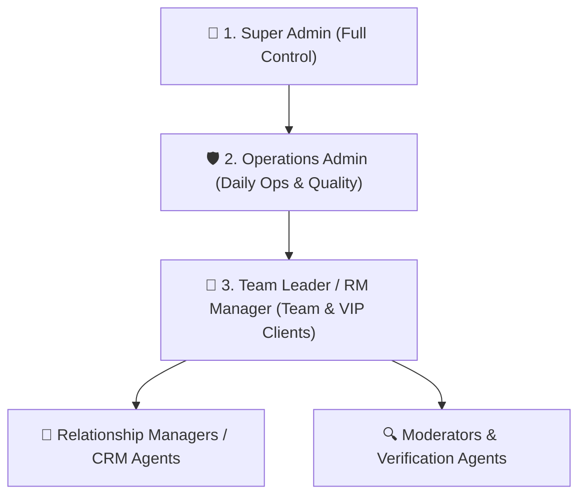
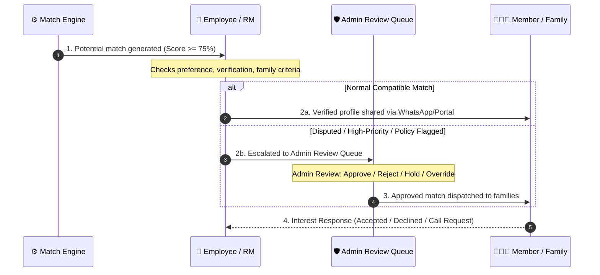
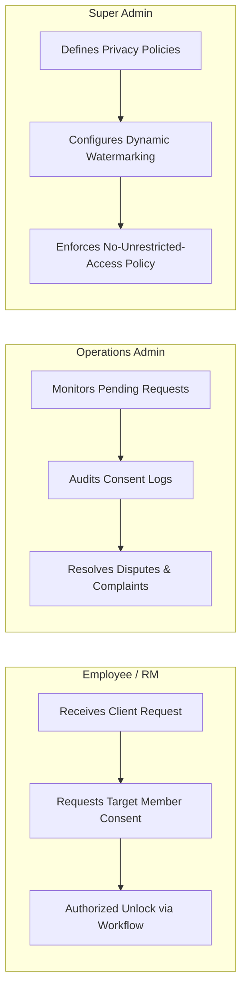

# 🏛️ Matrimony Admin Operations & Governance Architecture

> **Master Specification Document**  
> **Target System:** Sindhi Matrimony CRM & Operations Admin Portal  
> **Scope:** Admin Hierarchy, Matchmaking Review Flow, Deduplication Engine, Module Breakdown, Privacy Governance & Production Rules.

---

## 1. 👥 Matrimony Admin Hierarchy (3-Tier Governance)

Ek scalabe matrimony platform me Admin ka role micro-management nahi balki **policy control, quality assurance, exception handling aur business operations** hota hai.



| Admin Level | Target Roles | Core Responsibilities | Clearances & Boundaries |
|---|---|---|---|
| **Level 1: Super Admin** | `SUPER_ADMIN`, `SYSTEM_OWNER` | • Platform configurations & global matching policies<br>• Employee creation, role provisioning & permission scopes<br>• Payment gateways, refunds & pricing package adjustments<br>• Critical policy overrides (with mandatory justification audit) | Unlimited access across all 16 modules, financial ledgers, audit logs, and master toggles. |
| **Level 2: Operations Admin** | `ADMIN`, `OPERATIONS_HEAD` | • KYC & document verification queue supervision<br>• Lead routing & employee allocation<br>• Matchmaking quality checks & dispute resolution<br>• Member complaints, abuse reports & suspension decisions<br>• Marketing / WhatsApp broadcast approvals | Cannot modify master pricing plans, delete employee audit trails, or alter core database schemas. |
| **Level 3: Team Leader / RM Manager** | `CRM_MANAGER`, `TEAM_LEAD` | • Relationship Managers (RM) performance tracking<br>• SLA monitoring on pending follow-ups & call queues<br>• VIP / HNI client allocation & satisfaction reviews<br>• Review of RM-suggested matches prior to client dispatch | Scoped to assigned cluster/branch employees and active client matchmaking portfolios. |

---

## 2. 🎯 Matchmaking mein Admin ka Exact Role (Exception-Based Review)

### Golden Rule:
> ⚠️ **Har match par manual admin approval mandatory nahi hoga.** Normal compatible matches automated algorithm aur RM review se seamlessly dispatch honge. Admin review **sirf predefined high-risk ya policy-flagged cases** me trigger hoga.

### 4-Step Lifecycle Workflow



### Admin Control Suite (Match Review Actions)

1. **Approve:** Review pass hone par match ko client dispatch queue me push karna.
2. **Reject (Mandatory Reason):** Match unsuitable hone par standard reason code ke saath discard karna (*e.g., REJ_AGE_GAP, REJ_SALARY_MISMATCH, REJ_FAMILY_STATUS*).
3. **Hold:** Pending documents, unverified salary slip ya horoscope clarification aane tak roke rakhna.
4. **Reassign:** Kisi specific profile pair ko experienced ya regional RM ko assign karna.
5. **Override (Authorized Exception):** Borderline cases (e.g., age gap by 3 months, location preference deviation) ko Super Admin / Ops Admin sign-off aur reason log ke saath bypass karna.
6. **View History (Timeline Audit):** Complete chronological lifecycle: *Kisne generate kiya, kis RM ne shortlist kiya, kab share hua, aur client response kab aaya.*

---

## 3. 🔄 Deduplication & Idempotency Engine

### Problem Statement:
Jab backend automated engine aur Relationship Manager dono same match pair (*Rahul & Priya*) ko suggest ya process karein, to system duplicate records create na kare aur client ko double alert na bheje.

### Symmetrical Canonical Identity
Platform me har profile pair ko ek **normalized unique key** se identify kiya jata hai:

$$\text{CanonicalPairKey} = \min(\text{ID}_A, \text{ID}_B) + \text{":"} + \max(\text{ID}_A, \text{ID}_B)$$

Chahe input `(Rahul, Priya)` ho ya `(Priya, Rahul)`, dono ka pair key hamesha identical rahega:  
`SIND_001:SIND_002`.

### Idempotency Behavior Matrix

| Scenario | Trigger / Action | Expected System Behavior | Technical Implementation |
|---|---|---|---|
| **1. Same Pair Re-generated** | Daily cron re-evaluates Rahul–Priya | Existing match reused, no new row inserted. | `findMatchByPair(client, cand)` returns existing object. |
| **2. Employee Suggests Existing Pair** | RM shortlists pair already found by cron | Existing record reused; source appended (`EMPLOYEE_ASSISTED`). | `match.sources.push('EMPLOYEE_ASSISTED')` |
| **3. Admin Priority Bump** | Admin marks match as `HIGH_PRIORITY` | Existing record updated, timestamp refreshed, audit entry added. | `match.priority = 'HIGH'`, history entry created. |
| **4. Duplicate Notification Prevented** | Match pehle hi share ho chuka hai | Notification suppressed; client ko duplicate push/WhatsApp nahi jata. | `notificationDispatched: false`, status `SUPPRESSED_DUPLICATE`. |
| **5. Previously Rejected Pair** | Admin suggests a pair previously declined by client | Cooldown policy check; blocked unless explicit `allowReactivation: true` with reason. | Requires `SUPER_ADMIN` authorization and recorded rationale. |
| **6. Blocked / Suspended Pair** | Pair flagged for safety or harassment | Suggestion strictly blocked across both automated and manual channels. | Hard block checked via `isBlockedPair()`. |

---

## 4. 📦 Complete 16 Admin Modules Directory

| # | Module Name | Primary Admin Responsibilities | Key Actions / Screens |
|---|---|---|---|
| **01** | **Member Management** | Member profiles lifecycle: Pending, Active, Suspended, Archived, Paid. | 360° Profile view, edit profile, freeze account, export. |
| **02** | **Leads & Calling Desk** | Inquiries from ads/website, lead status, lead assignment to telecallers. | Call disposition, lead conversion, follow-up scheduler. |
| **03** | **Verification Desk** | KYC, Govt ID proof (Aadhaar/Passport), selfie verification, photo moderation. | Document magnifier, Approve/Reject badge, Re-upload request. |
| **04** | **Match Engine & Rules** | Global algorithm config (weights for age, gotra, education, city, income). | Weight tuning, Sagotra toggle, Manglik rules. |
| **05** | **Assisted Matchmaking** | RM assisted proposals, shortlist queue, mutual match coordination. | Handpicked match dispatch, family feedback logger. |
| **06** | **Horoscope & Kundli** | Ashtakoot Guna Milan (36 Gunas), Manglik Dosha calculator, birth chart review. | Kundli Milan card, Dosha analyzer, Astrologer note desk. |
| **07** | **Photo Privacy & Vault** | Parda / blurred photo requests, consent tracking, watermark enforcement. | Photo access audit, viewer-ID dynamic watermarking. |
| **08** | **Trust & Safety** | User abuse reports (*fake profile, money extortion, harassment*), fraud flags. | Report triage queue, blacklist phone/device, temporary freeze. |
| **09** | **Membership & Payments** | Packages (Silver, Gold, Platinum, VIP), offline payments, refund requests. | Invoice generator, payment reconciliation, renewal alerts. |
| **10** | **Employee Management** | Employee accounts, roles, departmental assignments, attendance/performance. | Granular permissions (`allowedSections`), performance KPIs. |
| **11** | **Success Registry** | Engaged / Married profiles offboarding, testimonials, landing page stories. | Archive profile, publish success story, RM gift hamper record. |
| **12** | **Biodata & WhatsApp** | 1-Click WhatsApp PDF Biodata generator with privacy mask (Blind/Full). | Template selector, direct WhatsApp Web API dispatch. |
| **13** | **Community Rules** | Sindhi Gotra exogamy (4-Gotra rule: Self, Mother, Dadi, Nani), subcaste filters. | Gotra master list, subcommunity exogamy matrix. |
| **14** | **Events & Sammelan** | Yuvak-Yuvati Parichay Sammelan (Virtual & Physical), registration, entry passes. | Candidate badge print, QR check-in, post-sammelan match batch. |
| **15** | **Reports & Analytics** | Platform metrics: Revenue, MRR, conversion rate, match acceptance rate, RM KPIs. | Filterable chart widgets, CSV export, daily summary. |
| **16** | **Audit Logs & Security** | Immutable trace of all administrative updates, overrides, exports, and bans. | Actor ID, IP address, timestamp, diff before/after values. |

---

## 5. 🔐 Privacy & Difference: Admin vs Employee

### Case Study: Unlocking a Private / Blurred Photo



* **Employee / RM:** Member ki photo bina unki consent ke unlock nahi kar sakta. Workflow ke through client ki explicit permission aane par hi view access activate hota hai.
* **Operations Admin:** Pending photo requests ki SLA check karta hai aur privacy violations ki complaints investigate karta hai.
* **Super Admin:** System-wide privacy policies set karta hai. Super Admin ke paas bhi bina audit trail ke private photos download ya circulate karne ka bypass nahi hona chahiye. Dynamic watermarking ensure karti hai ki photo leak hone par source traceable ho.

---

## 6. 📊 Admin Dashboard Layout & Review Queues

```
+-------------------------------------------------------------------------------------------------------+
|  👑 SINDHI MATRIMONY ADMIN PORTAL                                         [Active Role: SUPER_ADMIN]   |
+-------------------------------------------------------------------------------------------------------+
|  [ 👤 Members ]            [ 💍 Matches ]             [ 🛡️ Safety Flags ]       [ 💼 RM Operations ]    |
|  Total: 12,450             Generated: 4,120           Open Reports: 14         Active Portfolios: 180 |
|  Active: 9,820             Shared: 2,340              Unverified Docs: 38      Overdue Follow-ups: 26 |
|  Pending KYC: 142          Mutual Accepted: 412       Fraud Alerts: 3          VIP Match Backlog: 9   |
+-------------------------------------------------------------------------------------------------------+
|                                                                                                       |
|  ⚡ REAL-TIME ACTION QUEUES (Requiring Administrative Attention)                                     |
|                                                                                                       |
|  +--------------------------------+  +--------------------------------+                               |
|  | 📄 Profile Verification Queue  |  | ⚠️ Match Policy Exceptions     |                               |
|  | - 38 Govt ID uploads pending   |  | - 7 Horoscope / Age overrides  |                               |
|  | - 12 High-Income salary audits |  | - 2 Borderline Gotra reviews   |                               |
|  | [ Review Queue -> ]            |  | [ Review Queue -> ]            |                               |
|  +--------------------------------+  +--------------------------------+                               |
|                                                                                                       |
|  +--------------------------------+  +--------------------------------+                               |
|  | 🚨 Trust & Abuse Complaints    |  | 💍 Marriage & Success Reports  |                               |
|  | - 4 Misbehavior reports        |  | - 6 Couples reported engaged   |                               |
|  | - 1 Financial extortion flag   |  | - 3 Profiles ready for archive |                               |
|  | [ Priority Triage -> ]         |  | [ Review & Offboard -> ]       |                               |
|  +--------------------------------+  +--------------------------------+                               |
|                                                                                                       |
+-------------------------------------------------------------------------------------------------------+
```

---

## 7. ⚖️ Production ke 5 Mandatory Governance Rules

1. **Role-Based Access Control (RBAC):**
   * Har action role aur permission check ke baad hi execute ho (`canAccessRoute`, `hasPermission`). Unauthenticated ya unauthorized access par instant `403 Forbidden`.
2. **Comprehensive Immutable Audit Logs:**
   * Kisne kya change kiya, kab kiya, aur kyu kiya — har override, ban, verification status, aur payment refund mandatory actor ID aur timestamp ke saath store ho.
3. **Approval Workflows for Critical Operations:**
   * Permanent account deletion, negative balance refunds, global gotra rule modifications, aur ban overrides ke liye minimum 2-step verification ya Super Admin sign-off mandatory ho.
4. **Data Privacy & Watermark Governance:**
   * Phone number, exact home address, Kundli birth time, aur identity documents role-based masked rahenge. Sensitive exports (PDF biodata) par viewing agent aur platform ka watermarking enforce hoga.
5. **Idempotency & Zero-Duplicate Guarantee:**
   * Matches, automated push notifications, payment webhooks, aur RM attribution me strict deduplication logic lagna chahiye taaki duplicate execution se client irritation aur data corruption na ho.

---

*(Document generated and maintained under Sindhi Matrimony Core Technical Architecture)*
