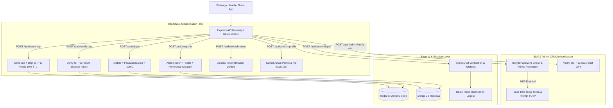

# 🔐 Complete Authentication & Authorization Architecture Documentation
**Sindhi Matrimony Enterprise Backend (`/api/v1/auth`)**

---

## 1. Executive Architecture Overview

The Sindhi Matrimony backend implements an enterprise-grade, decoupled identity and authentication architecture. The system separates the **User Account** (login credentials, phone number, security, and subscription billing) from the **Candidate Profile** (matrimonial biodata, horoscopes, partner preferences, photos). This enables a 1:Many relationship where a single phone number can manage up to 4 distinct matrimonial profiles (e.g. self, son, daughter, sibling).



---

## 2. Core Identity Models & Data Contracts

### 2.1 User Model (`User.js`)
* **Primary Key:** `_id` (ObjectId)
* **Identity:** `phone` (Indexed, Unique with `isDeleted: false`), `countryCode` (default: `+91`), `email` (sparse index)
* **Security:** `password` (`select: false`, bcrypt hash), `status` (`ACTIVE`, `SUSPENDED`, `DELETED`)
* **Multi-Profile Pointer:** `activeProfileId` (ObjectId referencing active `Profile`)
* **Quota:** `maxProfilesAllowed` (Default: `4`)
* **Onboarding Tracking:** `onboardingStep` (1–6), `isOnboardingComplete` (Boolean)
* **Telemetry:** `clientPlatform` (`WEB`, `ANDROID`, `IOS`), `lastLoginAt`, `fcmTokens`

### 2.2 Profile Model (`Profile.js`)
* **Primary Key:** `_id` (ObjectId)
* **Owner Link:** `userId` (Indexed, **non-unique** to allow 1:N)
* **Candidate Fingerprint:** `deduplicationHash` (`SHA-256(phone + gender + dob + name)`)
* **Attributes:** `name`, `profileFor` (`MYSELF`, `SON`, `DAUGHTER`, `BROTHER`, `SISTER`, `RELATIVE`, `CLIENT`), `gender`, `subcaste`, `dateOfBirth`, `age`, `height`, `maritalStatus`, `education`, `profession`, `annualIncome`, `location`, `isPrimary`, `status` (`ACTIVE`, `INACTIVE`, `PENDING_VERIFICATION`, `REJECTED`, `SUSPENDED`)

### 2.3 ProfileAccessGrant Model (`ProfileAccessGrant.js`)
* **Compound Index:** `{ profileId: 1, granteeUserId: 1 }` (Unique)
* **Roles:** `OWNER`, `CO_MANAGER` (can edit/view matches), `VIEWER` (read-only view)

---

## 3. Candidate Auth Flow & Endpoints Specification

### 3.1 Pre-Registration Phone Availability Check
Checks in sub-5ms whether a mobile number is already registered before requesting OTP.

* **Endpoint:** `POST /api/v1/auth/check-phone`
* **Access:** Public (No Bearer token required)
* **Rate Limit:** Standard Gateway Limiter
* **Request Body:**
```json
{
  "phone": "9829012345",
  "countryCode": "+91"
}
```
* **Success Response (HTTP 200 OK):**
```json
{
  "error": false,
  "code": 200,
  "status": "OK",
  "message": "Mobile number available for registration.",
  "data": {
    "phone": "9829012345",
    "countryCode": "+91",
    "isRegistered": false
  }
}
```

---

### 3.2 Send Registration OTP
Generates a cryptographically secure 4-digit OTP, stores it in Redis (`otp:register:<phone>`, 10m TTL), and triggers asynchronous SMS/WhatsApp alerts.

* **Endpoint:** `POST /api/v1/auth/send-otp` (Alias: `/api/v1/auth/sendOtp`, `/api/v1/auth/users/send-otp`)
* **Access:** Public
* **Rate Limit:** `otpRateLimiter` (Max 5 requests per 10 minutes per IP/Phone)
* **Request Body:**
```json
{
  "phone": "9829012345",
  "countryCode": "+91",
  "purpose": "REGISTER",
  "name": "Simran Vaswani",
  "profileFor": "MYSELF",
  "step": 1
}
```
* **Success Response (HTTP 200 OK):**
```json
{
  "error": false,
  "code": 200,
  "status": "OK",
  "message": "OTP has been sent to your mobile number.",
  "data": {
    "phone": "9829012345",
    "mobile": "9829012345",
    "countryCode": "+91",
    "isExistingUser": false,
    "purpose": "REGISTER",
    "name": "Simran Vaswani",
    "profileFor": "MYSELF",
    "step": 1,
    "token": "7a9f8b2c4e1d"
  }
}
```
* **Error Scenarios:**
  * **HTTP 409 Conflict:** Mobile number already exists under an active account.
  * **HTTP 403 Forbidden:** Account under this mobile number has been suspended.
  * **HTTP 400 Bad Request:** Requested purpose is `LOGIN` (backend enforces password-based login for candidates).

---

### 3.3 Verify OTP
Validates the entered 4-digit OTP against Redis. For `REGISTER`, it mints an authorized registration session token (`reg_verified:<token>`, 24h TTL) allowing wizard continuation.

* **Endpoint:** `POST /api/v1/auth/verify-otp` (Alias: `/api/v1/auth/users/verify-otp`)
* **Access:** Public
* **Rate Limit:** `authRateLimiter` (Max 15 attempts per 15 minutes)
* **Request Body:**
```json
{
  "phone": "9829012345",
  "otp": "1234",
  "purpose": "REGISTER",
  "countryCode": "+91",
  "step": 2
}
```
* **Success Response (HTTP 200 OK):**
```json
{
  "error": false,
  "code": 200,
  "status": "OK",
  "message": "OTP verified successfully.",
  "data": {
    "phone": "9829012345",
    "countryCode": "+91",
    "purpose": "REGISTER",
    "verified": true,
    "isOtpVerified": true,
    "step": 2,
    "token": "eyJhbGciOiJIUzI1NiIsInR5cCI6IkpXVCJ9...",
    "nextStep": "/registration/basic-info"
  }
}
```
* **Development Master OTP:** `1234` is universally accepted in non-production environments (`process.env.NODE_ENV !== "production"`).

---

### 3.4 Multi-Step Registration Draft Autosave
Saves onboarding progress into Redis drafts so candidates can resume multi-step registration even if they close their browser or app.

* **Endpoint:** `POST /api/v1/auth/register-step` (Alias: `/api/v1/auth/registerStep`)
* **Access:** Public
* **Request Body:**
```json
{
  "phone": "9829012345",
  "step": 3,
  "gender": "FEMALE",
  "dob": "1997-04-12",
  "subcaste": "Bhaiband",
  "maritalStatus": "NEVER_MARRIED",
  "education": "Master of Computer Applications",
  "profession": "Software Engineer",
  "city": "Ahmedabad",
  "state": "Gujarat"
}
```
* **Success Response (HTTP 200 OK):**
```json
{
  "error": false,
  "code": 200,
  "status": "OK",
  "message": "Step 3 details saved successfully.",
  "data": {
    "phone": "9829012345",
    "step": 3,
    "nextStep": "/registration/personal-religious-info"
  }
}
```

---

### 3.5 Quick Candidate Registration
Atomically creates the `User` account, primary `Profile`, and default `PartnerPreference` records. Automatically links `activeProfileId` and returns JWT Access and Refresh tokens.

* **Endpoint:** `POST /api/v1/auth/register` (Alias: `/api/v1/auth/users/register`)
* **Access:** Public
* **Rate Limit:** `registerRateLimiter`
* **Request Body:**
```json
{
  "phone": "9829012345",
  "otp": "1234",
  "token": "eyJhbGciOiJIUzI1NiIsInR5cCI6IkpXVCJ9...",
  "name": "Simran Vaswani",
  "password": "SecurePassword@123",
  "profileFor": "MYSELF",
  "gender": "FEMALE",
  "subcaste": "Bhaiband",
  "dob": "1997-04-12",
  "maritalStatus": "NEVER_MARRIED",
  "height": 165,
  "education": "Master of Computer Applications",
  "profession": "Senior UI/UX Designer",
  "annualIncome": "12 - 15 Lakhs",
  "city": "Ahmedabad",
  "state": "Gujarat",
  "clientPlatform": "ANDROID",
  "fcmToken": "fcm_device_token_xyz"
}
```
* **Success Response (HTTP 201 Created):**
```json
{
  "error": false,
  "code": 201,
  "status": "CREATED",
  "message": "Candidate account registered successfully.",
  "data": {
    "token": "eyJhbGciOiJIUzI1NiIsInR5cCI6IkpXVCJ9.eyJ1c2VySWQiOiI2YWQzYzBmZjUxYmJhYWZiYWQ5OWYzOWMiLCJyb2xlIjoxLCJwaG9uZSI6Ijk4MjkwMTIzNDUiLCJwcm9maWxlSWQiOiI2NGYxYTJiM2M0ZDVlNmY3YThiOWMwZDEiLCJhY3RpdmVQcm9maWxlSWQiOiI2NGYxYTJiM2M0ZDVlNmY3YThiOWMwZDEiLCJwcm9maWxlUm9sZSI6Ik9XTkVSIiwiZXhwIjoxNzkzMDk3NjAwfQ...",
    "refreshToken": "eyJhbGciOiJIUzI1NiIsInR5cCI6IkpXVCJ9...",
    "user": {
      "_id": "6ad3c0ff51bbaafbad99f39c",
      "phone": "9829012345",
      "email": null,
      "role": 1,
      "activeProfileId": "64f1a2b3c4d5e6f7a8b9c0d1",
      "maxProfilesAllowed": 4,
      "onboardingStep": 1,
      "isOnboardingComplete": true
    },
    "profile": {
      "_id": "64f1a2b3c4d5e6f7a8b9c0d1",
      "name": "Simran Vaswani",
      "profileFor": "MYSELF",
      "gender": "FEMALE",
      "subcaste": "Bhaiband",
      "age": 29,
      "location": {
        "city": "Ahmedabad",
        "state": "Gujarat"
      },
      "isPrimary": true,
      "status": "ACTIVE",
      "membershipTier": "FREE",
      "verificationBadge": false
    }
  }
}
```
* **Rollback Safety:** If `Profile` or `PartnerPreference` creation fails after `User` document generation, an atomic `User.deleteOne({ _id })` rollback is executed immediately to eliminate orphaned credentials.

---

### 3.6 Candidate Password Login
Sub-10ms high-throughput login using indexed `{ phone: 1, isDeleted: 1 }` lookup and bcrypt password verification.

* **Endpoint:** `POST /api/v1/auth/login` (Alias: `/api/v1/auth/users/login`)
* **Access:** Public
* **Rate Limit:** `authRateLimiter`
* **Request Body:**
```json
{
  "phone": "9829012345",
  "password": "SecurePassword@123",
  "fcmToken": "fcm_device_token_xyz",
  "clientPlatform": "ANDROID"
}
```
* **Success Response (HTTP 200 OK):**
```json
{
  "error": false,
  "code": 200,
  "status": "OK",
  "message": "Logged in successfully.",
  "data": {
    "token": "eyJhbGciOiJIUzI1NiIsInR5cCI6IkpXVCJ9...",
    "refreshToken": "eyJhbGciOiJIUzI1NiIsInR5cCI6IkpXVCJ9...",
    "user": {
      "_id": "6ad3c0ff51bbaafbad99f39c",
      "phone": "9829012345",
      "role": 1,
      "status": "ACTIVE",
      "activeProfileId": "64f1a2b3c4d5e6f7a8b9c0d1"
    }
  }
}
```

---

### 3.7 Forgot & Reset Password Flow
Secure 2-step password recovery with single-use Redis tokens.

1. **Step 1: Request Reset Code (`POST /api/v1/auth/forgot-password`)**
   * Request Body: `{ "phone": "9829012345" }`
   * Response: Generic success message (prevents phone number enumeration). Dispatches OTP via SMS/WhatsApp if account exists.

2. **Step 2: Verify Recovery OTP (`POST /api/v1/auth/verify-otp`)**
   * Request Body: `{ "phone": "9829012345", "otp": "1234", "purpose": "RESET_PASSWORD" }`
   * Response: Returns `resetToken` with 10-minute expiry stored at `reset_token:<phone>`.

3. **Step 3: Reset Credentials (`POST /api/v1/auth/reset-password`)**
   * Request Body:
```json
{
  "phone": "9829012345",
  "newPassword": "NewSecurePassword@456",
  "token": "eyJhbGciOiJIUzI1NiIsInR5cCI6IkpXVCJ9..."
}
```
   * Action: Hashes new password, updates `User.password`, and deletes `reset_token:<phone>` to ensure single-use protection.

---

### 3.8 JWT Token Refresh & Token Rotation
Renews expired Access Tokens (2-day lifespan) using a valid 30-day Refresh Token without forcing the user to log in again.

* **Endpoint:** `POST /api/v1/auth/refresh-token` (Alias: `/api/v1/auth/refreshToken`)
* **Access:** Public (Requires valid Refresh Token in body)
* **Request Body:**
```json
{
  "refreshToken": "eyJhbGciOiJIUzI1NiIsInR5cCI6IkpXVCJ9..."
}
```
* **Success Response (HTTP 200 OK):**
```json
{
  "error": false,
  "code": 200,
  "status": "OK",
  "message": "Token refreshed successfully.",
  "data": {
    "token": "eyJhbGciOiJIUzI1NiIsInR5cCI6IkpXVCJ9...(new)",
    "accessToken": "eyJhbGciOiJIUzI1NiIsInR5cCI6IkpXVCJ9...(new)",
    "refreshToken": "eyJhbGciOiJIUzI1NiIsInR5cCI6IkpXVCJ9...(new)",
    "user": {
      "_id": "6ad3c0ff51bbaafbad99f39c",
      "phone": "9829012345",
      "role": 1,
      "activeProfileId": "64f1a2b3c4d5e6f7a8b9c0d1"
    }
  }
}
```

---

### 3.9 Candidate Logout
* **Endpoint:** `POST /api/v1/auth/logout` (Alias: `/api/v1/auth/userLogout`)
* **Headers:** `Authorization: Bearer <token>`
* **Action:** Blacklists the JWT in Redis (`blacklist:token:<hash>`) with TTL equal to the token's remaining lifespan.

---

## 4. Multi-Profile Switching & Delegation Flow

### 4.1 Fetch Managed Profiles
Lists all profiles owned by or delegated to the authenticated account.

* **Endpoint:** `GET /api/v1/auth/my-profiles`
* **Headers:** `Authorization: Bearer <token>`
* **Success Response (HTTP 200 OK):**
```json
{
  "error": false,
  "code": 200,
  "status": "OK",
  "data": {
    "activeProfileId": "64f1a2b3c4d5e6f7a8b9c0d1",
    "totalCount": 2,
    "maxProfilesAllowed": 4,
    "profiles": [
      {
        "_id": "64f1a2b3c4d5e6f7a8b9c0d1",
        "name": "Simran Vaswani",
        "profileFor": "MYSELF",
        "gender": "FEMALE",
        "age": 29,
        "isPrimary": true,
        "isActive": true,
        "profileRole": "OWNER",
        "status": "ACTIVE"
      },
      {
        "_id": "64f1a2b3c4d5e6f7a8b9c0d2",
        "name": "Karan Vaswani",
        "profileFor": "BROTHER",
        "gender": "MALE",
        "age": 26,
        "isPrimary": false,
        "isActive": false,
        "profileRole": "OWNER",
        "status": "ACTIVE"
      }
    ]
  }
}
```

---

### 4.2 Create Secondary Profile
Enables parents or siblings to create an additional profile under the same login credentials.

* **Endpoint:** `POST /api/v1/auth/profiles` (Alias: `/api/v1/auth/users/profiles`)
* **Headers:** `Authorization: Bearer <token>`
* **Request Body:**
```json
{
  "name": "Karan Vaswani",
  "profileFor": "BROTHER",
  "gender": "MALE",
  "dob": "2000-08-19",
  "subcaste": "Larkana",
  "maritalStatus": "NEVER_MARRIED",
  "height": 178,
  "education": "B.Tech Computer Science",
  "profession": "Frontend Engineer",
  "city": "Pune",
  "state": "Maharashtra"
}
```
* **Deduplication Check:** Generates a SHA-256 fingerprint from `phone + gender + dob + name`. If a profile already matches this hash, returns `HTTP 409 Conflict`.
* **Quota Check:** If the account already has 4 profiles, returns `HTTP 403 Forbidden` (`You have reached the maximum allowed limit of 4 profiles`).

---

### 4.3 Switch Active Profile (BOLA Protected)
Switches the session's active profile and issues a fresh JWT with updated `activeProfileId`.

* **Endpoint:** `POST /api/v1/auth/switch-profile` (Alias: `/api/v1/auth/users/switch-profile`)
* **Headers:** `Authorization: Bearer <token>`
* **Request Body:**
```json
{
  "targetProfileId": "64f1a2b3c4d5e6f7a8b9c0d2"
}
```
* **Security Validation:**
  1. Checks if `targetProfileId` has `userId === req.auth.userId`.
  2. If not, checks `ProfileAccessGrant` for `granteeUserId === req.auth.userId`.
  3. If neither matches, rejects with `HTTP 403 Forbidden` (`Unauthorized profile switch. You do not own or have delegation rights to this profile`).
* **Success Response (HTTP 200 OK):**
```json
{
  "error": false,
  "code": 200,
  "status": "OK",
  "message": "Switched active profile to Karan Vaswani.",
  "data": {
    "activeProfileId": "64f1a2b3c4d5e6f7a8b9c0d2",
    "token": "eyJhbGciOiJIUzI1NiIsInR5cCI6IkpXVCJ9...",
    "profileRole": "OWNER"
  }
}
```

---

## 5. Administrative & Staff Auth Flow

The backend CRM supports role-based administrative authentication with record scoping (`ALL`, `BRANCH`, `TEAM`, `OWN`) and optional 2-Step Multi-Factor Authentication (MFA).

### 5.1 Pre-seeded Roles & Permissions
* `SUPER_ADMIN` (Role: `SUPER_ADMIN`, Scope: `ALL`)
* `CRM_MANAGER` / `ADMIN` (Role: `CRM_MANAGER`, Scope: `TEAM` / `BRANCH`)
* `MATCHMAKER` (Role: `MATCHMAKER`, Scope: `BRANCH`)
* `TELECALLER` / `CRM_AGENT` (Role: `TELECALLER`, Scope: `OWN`)
* `FINANCE_MANAGER` (Role: `FINANCE_MANAGER`, Scope: `ALL`)
* `MODERATOR` (Role: `MODERATOR`, Scope: `ALL`)

### 5.2 Admin Login
* **Endpoint:** `POST /api/v1/auth/admin/login`
* **Access:** Public
* **Request Body:**
```json
{
  "email": "admin@sindhimarriage.in",
  "password": "Admin@1234",
  "requireMfaCheck": false
}
```
* **Success Response (Direct Login - HTTP 200 OK):**
```json
{
  "error": false,
  "code": 200,
  "status": "OK",
  "message": "Super Admin authenticated successfully.",
  "data": {
    "accessToken": "eyJhbGciOiJIUzI1NiIsInR5cCI6IkpXVCJ9...",
    "refreshToken": "eyJhbGciOiJIUzI1NiIsInR5cCI6IkpXVCJ9...",
    "employee": {
      "id": "emp_001",
      "employeeId": "EMP001",
      "fullName": "Super Administrator",
      "email": "admin@sindhimarriage.in",
      "role": "SUPER_ADMIN",
      "department": "Executive Management",
      "designation": "Super Administrator",
      "recordScope": "ALL",
      "allowedSections": ["dashboard", "leads", "tasks", "chat", "members", "finance", "settings"]
    }
  }
}
```

### 5.3 Admin 2-Step MFA Challenge (When MFA Enabled)
1. **Challenge Triggered (HTTP 200 OK):**
```json
{
  "error": false,
  "code": 200,
  "status": "OK",
  "message": "Super Admin MFA verification code required.",
  "data": {
    "requiresMFA": true,
    "tempToken": "eyJhbGciOiJIUzI1NiIsInR5cCI6IkpXVCJ9(10m expiry)...",
    "message": "Enter your 4-digit verification code."
  }
}
```
2. **Verify TOTP Code:**
   * **Endpoint:** `POST /api/v1/auth/admin/verify-mfa`
   * **Request Body:**
```json
{
  "tempToken": "eyJhbGciOiJIUzI1NiIsInR5cCI6IkpXVCJ9...",
  "totpCode": "1234"
}
```
   * **Success:** Issues final 2-day `accessToken` and 30-day `refreshToken`.

### 5.4 Get Admin Profile
* **Endpoint:** `GET /api/v1/auth/admin/me`
* **Headers:** `Authorization: Bearer <adminToken>`
* **Success Response:** Returns full authenticated staff profile with clearance rights.

---

## 6. Middlewares, Security & Token Interceptors

| Middleware | File Path | Function & Role |
| :--- | :--- | :--- |
| **`jwtAuth()`** | `middlewares/jwt.js` | Uses `express-jwt` to inspect `Authorization: Bearer <token>`. Whitelists public paths (Health, Dropdowns, Public stories/plans, and Auth endpoints). Populates `req.auth`. |
| **`accessCheckMiddleware`** | `middlewares/accessCheckMiddleware.js` | Enforces staff RBAC and injects `req.recordScope` based on staff role (`ALL`, `BRANCH`, `TEAM`, `OWN`). |
| **`requireProfileAccess()`** | `middlewares/profileContextMiddleware.js` | Verifies whether the requesting candidate owns or is granted delegation rights to `activeProfileId`. Neutralizes BOLA / IDOR vulnerabilities. |
| **`rateLimiter`** | `middlewares/rateLimiter.js` | Multi-tier rate limiting backed by Redis or In-Memory Sliding Windows (`rate:auth`, `rate:otp`, `rate:register`). |
| **`socketAuthMiddleware`** | `middlewares/socketAuthMiddleware.js` | Validates JWT token on WebSocket connection handshake (`io.use(socketAuthMiddleware)`). Joins rooms `user_<id>` and `agent_<id>`. |

---

## 7. Complete Test Cases & Scenarios Catalog

All authentication paths are covered by automated unit and integration tests located in `test/integration/authFlow.test.js`, `test/unit/adminAuth.test.js`, and `test/integration/multiProfileScenarios.test.js`.

### 7.1 Candidate Auth Scenarios (`authFlow.test.js`)
* **Scenario 1:** `GET /api/v1/health` is publicly accessible without token.
* **Scenario 2:** `GET /api/v1/profile/me` strictly rejects unauthenticated requests with HTTP 401.
* **Scenario 3:** OTP Service generates 4 digits; Master OTP `1234` accepted in dev; invalid OTP fails.
* **Scenario 4:** JWT minting, claims validation (`id`, `role`, `activeProfileId`), and token expiration.
* **Scenario 5:** `POST /api/v1/auth/send-otp` rejects malformed phone numbers with HTTP 422.
* **Scenario 6:** `POST /api/v1/auth/register` rejects missing required fields (`name`, `gender`) with HTTP 422.
* **Scenario 7:** Both canonical `/auth/send-otp` and nested `/auth/users/send-otp` route to identical handlers.
* **Scenario 8:** Authenticated request passes JWT middleware and correctly decodes `req.auth`.
* **Scenario 9:** `POST /api/v1/auth/check-phone` responds under 5ms with `isRegistered` flag.
* **Scenario 10:** Cross-purpose OTP verification (`verifyOtpAnyPurpose`) works for dual-mode logins.
* **Scenario 11–13:** `POST /api/v1/auth/login` input validation (empty payload, invalid phone, missing password).
* **Scenario 14:** `POST /api/v1/auth/login` returns HTTP 404 for unregistered phone numbers.
* **Scenario 15:** Direct and nested login routes execute identically.
* **Scenario 16:** `POST /api/v1/auth/login` returns HTTP 200 with JWT, refresh token, and user context.

### 7.2 Multi-Profile & Decoupling Scenarios (`multiProfileScenarios.test.js`)
* **TC-M1:** `Profile` schema allows multiple profiles under single `userId` (`unique: true` removed).
* **TC-M2:** `User` schema holds `activeProfileId` and `maxProfilesAllowed = 4`.
* **TC-M3:** `ProfileAccessGrant` enforces compound unique index on `{ profileId: 1, granteeUserId: 1 }`.
* **TC-15 / SC-09:** SHA-256 candidate deduplication fingerprint consistency prevents identical profiles.
* **TC-M4:** Issued JWT contains `userId`, `activeProfileId`, and `profileRole` claims.
* **TC-M5–M7:** Multi-profile routes enforce authentication (401) and schema validation (422).
* **SC-03 & SC-04:** Adding secondary profile increments count up to limit 4; 5th profile blocked with 403.
* **SC-06 & SC-07:** BOLA Guard: Attempting to switch to another user's profile without grant is blocked with 403.
* **TC-M9–M12:** `requireProfileAccess` middleware enforces role hierarchy (`VIEWER` cannot modify profile).

### 7.3 Admin & Staff Auth Scenarios (`adminAuth.test.js`)
* **TC-A1:** Direct Super Admin Login with seeded credentials returns tokens and `ALL` scope.
* **TC-A2:** Invalid admin password rejected with HTTP 401.
* **TC-A3:** Two-step MFA challenge (`requireMfaCheck: true`) issues `tempToken`, verified with code `1234`.
* **TC-A4:** Authenticated `GET /api/v1/auth/admin/me` returns employee identity and clearance rights.

---

## 8. Failure Modes & Edge Case Matrix

| Edge Case | Backend Action | HTTP Status | Response Message |
| :--- | :--- | :--- | :--- |
| **Account Suspended** | Block login and OTP dispatch | `403 Forbidden` | `"Your account has been suspended. Please contact support."` |
| **Already Registered Phone** | Send-OTP fails fast for purpose REGISTER | `409 Conflict` | `"An account with this mobile number already exists. Please log in directly."` |
| **Expired / Invalid OTP** | Verification fails | `400 Bad Request` | `"Invalid or expired verification code."` |
| **Rate Limit Exceeded** | Redis sliding window hits limit | `429 Too Many Requests` | `"Too many requests from this IP. Please try again after 10 minutes."` |
| **No Password Set on Account** | Account created via staff / legacy import | `400 Bad Request` | `"No password is set on this account. Please use 'Forgot Password' to create your password."` |
| **BOLA IDOR Profile Switch** | User attempts switching to unowned profile | `403 Forbidden` | `"Unauthorized profile switch. You do not own or have delegation rights to this profile."` |
| **Max Profiles Exceeded** | Candidate attempts creating 5th profile | `403 Forbidden` | `"You have reached the maximum allowed limit of 4 profiles under one mobile number."` |
| **Profile Creation Crash** | Rollback triggered | `500 Internal Error` | Newly created `User` record deleted atomically to prevent orphaned data. |
| **Expired Refresh Token** | Rotation rejected | `401 Unauthorized` | `"Invalid or expired refresh token. Please login again."` |
| **Logged Out Token Used** | Redis token blacklist check hits | `401 Unauthorized` | `"Invalid or expired authentication token. Please login again."` |
